# BTM Data Map

Use the BTM Data Map editor in the Azure Logic Apps (Standard) extension to create and edit `.btm` maps, connect source and target XML schemas, test transformations, and publish runtime artifacts. The editor is included in the Standard extension; a separate mapper extension is not required.

This reference describes the mapper UI, including its schema panes, canvas, links, properties, pages, Assistant, testing, and publishing. It does not describe the individual functoids or their transformation rules. Existing `.lml` maps use a different editor; the controls described here apply to `.btm` files.

Screenshots use the dark theme and sample map, schema, project, and Azure destination names.

## Contents

- [Feature Index](#feature-index)
- [Create or Open a Map](#create-or-open-a-map)
- [Import a Legacy BizTalk Map](#import-a-legacy-biztalk-map)
- [Start With the Tutorial](#start-with-the-tutorial)
- [Editor Layout and Main Toolbar](#editor-layout-and-main-toolbar)
- [Source and Target Schemas](#source-and-target-schemas)
- [Schema Node Properties](#schema-node-properties)
- [Canvas Navigation and Layout](#canvas-navigation-and-layout)
- [Create and Manage Links](#create-and-manage-links)
- [Link Properties](#link-properties)
- [Links Toolbar](#links-toolbar)
- [Selection and Clipboard](#selection-and-clipboard)
- [Pages](#pages)
- [Grid Properties](#grid-properties)
- [Assistant](#assistant)
- [Validate and Compile](#validate-and-compile)
- [Test Input and Test Map](#test-input-and-test-map)
- [Publish](#publish)
- [Save and Troubleshoot](#save-and-troubleshoot)

## Feature Index

| Area | Available features |
| --- | --- |
| Maps and projects | Create `.btm` maps; open maps visually or as text; import existing BizTalk maps and dependencies. |
| Guided tutorial | Opt-in sample schemas; source and target selection; guided connections; input, test, and publish helpers. |
| Schema selection | Project schema dropdowns, adding an XSD file, replacing schemas, and choosing a root from multi-root schemas. |
| Schema navigation | Resize panes, expand/collapse nodes or subtrees, expand linked nodes, name/XPath search, previous/next matches, and coalesce unrelated nodes. |
| Schema node tools | View properties, copy XPath, suggest matches, trace related mappings, set source test values, and assign eligible target constants. |
| Canvas | Hand panning, scrollbars, zoom, reset zoom, Fit layout, moving items, and selection. |
| Links | Direct links, transformation chains, scoped branch linking, auto-link by name, endpoint retargeting, labels, and source/target directives. |
| Mapping visibility | Link viewport scope, partial-link coloring, tracing, automatic endpoint reveal, related-mapping filtering, and compiler diagnostic links. |
| Editing | Multi-selection, select all, cut/copy/paste, delete, undo/redo through the document, and move mappings to another page. |
| Pages | Add, select, rename, and delete pages; organize one map across multiple pages. |
| Map settings | Grid Properties for namespaces, script precedence, output headers, and custom compiler artifacts. |
| Assistant | Describe changes, attach reference files, review proposed changes, and apply validated edits. |
| Validation and testing | Validate and Compile, upload or generate input, edit XML, Test Map, and inspect generated output and diagnostics. |
| Publishing | Publish compiled maps, schemas, and required assemblies to a local workspace Logic App or an existing Azure Logic Apps Standard resource. |

## Create or Open a Map

1. Open a workspace that contains a mapper project. To add one, use **Create Project > Add mapper** in the Azure **Workspace** view. See the [workspace setup guide](workspace-and-mapper-upgrade.md#create-or-extend-a-workspace) for project creation and legacy workspace conversion.
2. In the mapper project, choose **Add new map...**, enter a map name, and open the resulting `.btm` file.
3. Choose source and target schemas, create links and transformations, then save the map.

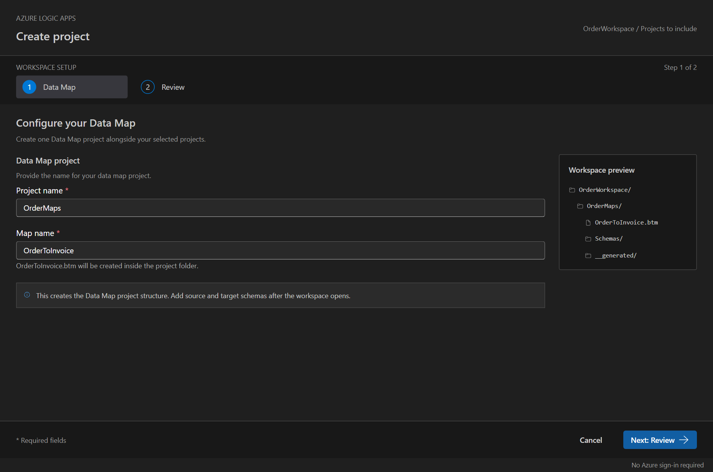

The mapper project contains authoring maps at its root, schemas under `Schemas`, and generated files under `__generated`. Imported maps can also have an `Artifacts` directory for dependencies. Keep referenced files with the map in source control.

Opening an existing `.btm` uses the visual editor. If a map opens as XML, use VS Code's **Reopen Editor With...** action and select the Data Mapper editor. Use **Edit Data Map as Text** when you intentionally need the XML representation. Save or discard text edits before returning to the visual editor.

## Import a Legacy BizTalk Map

You can import a BizTalk `.btm` map and continue editing it in this UI. Importing creates a project copy; it does not deploy the map or modify the original BizTalk project.

1. Back up or commit the original BizTalk project and the destination mapper project.
2. Keep the original `.btm`, referenced `.xsd` files, imported/included schemas, and any custom XSLT, extension-object XML, or assemblies available on disk. A map that refers to a .NET schema type still needs its source XSD to resolve that reference.
3. Open or create a mapper project in the Standard extension.
4. On that project's mapper actions, choose **Import data map...** and select the legacy `.btm`. If prompted, select the destination mapper project.
5. Review the import notification, especially warnings about missing schemas or custom artifacts. The importer copies resolved dependencies into the project and adjusts references. An existing map name receives an unused name instead of being overwritten.
6. Open the imported map and verify both schema trees, selected roots, page names, links, node values, and custom configuration. Resolve missing schema references with the schema dropdowns or **Add new schema...**.
7. If imported functoids overlap or are outside the visible area, select the affected page and use **Fit**. This changes their saved layout; it does not merely zoom out.
8. Use **Validate and Compile**, then **Test Map** with representative inputs. Compare the output with the original BizTalk map's expected output before publishing.

Supported dependencies are copied when they can be resolved. Do not ignore import warnings or assume that a custom assembly, remote schema reference, or machine-specific dependency is available in the destination environment. Keep custom artifacts referenced by the imported map; moving or deleting them can break compilation or testing.

Import is different from the [workspace upgrade](workspace-and-mapper-upgrade.md#open-an-existing-project), which separates legacy Logic App and mapper folders. Neither operation converts `.lml` maps into `.btm`. An unsupported map dialect or unavailable legacy/custom component can require manual changes; importing is not a guarantee of identical runtime behavior.

## Start With the Tutorial

An empty map offers a dismissible **Start Tutorial** callout in the canvas. No sample files are created until you start it.

1. Select **Start Tutorial** in a trusted mapper workspace. Sample input and output schemas are added under `Schemas`. Existing files are not overwritten; conflicting sample names receive unused names.
2. Select the offered **TutorialInput** schema from the source dropdown.
3. Select the offered **TutorialOutput** schema from the target dropdown.
4. Select the highlighted **Lowercase** item in the **String** palette category to add it to the canvas.
5. Draw a line from the source **Name** connector to the input connector on the left of Lowercase.
6. Draw a line from Lowercase's output connector on the right to the target **Name** connector.
7. Open **Test Input** to upload XML or generate an instance. You can also enter this XML in **Input Instance**:

   ```xml
   <TutorialInput>
     <Name>Ada LOVELACE</Name>
   </TutorialInput>
   ```

8. Choose the highlighted **Test Map** button. After a successful run, the output Name value is `ada lovelace`.
9. The final helper highlights **Publish** and links to this reference. Publishing remains an explicit action; the tutorial does not publish for you.

Each callout advances after its action completes; there is no **Next** button. During the tutorial, editing is restricted to the required actions. Dismiss the callout at any time to restore normal editing without deleting sample files or completed work. Normal editing is also restored at the final Publish helper. A failed test remains on the testing step so you can correct the input and retry.

## Editor Layout and Main Toolbar

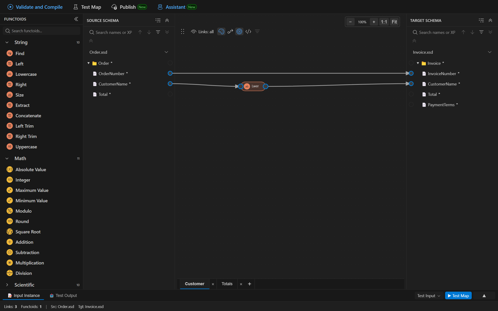

| Element | Purpose |
| --- | --- |
| Main toolbar | Provides **Validate and Compile**, **Test Map**, **Publish**, and **Assistant**. Its status area reports current operations. |
| Functoids pane | Search transformation components, expand/collapse categories, or collapse the pane. Click an item to add it near the visible canvas center, or drag it to a chosen position. Existing nearby items are avoided for click placement. |
| Source schema, on the left | Shows input elements, records, attributes, and their connectors. |
| Canvas, in the middle | Shows transformation components and mapping lines. Use its zoom controls and Links toolbar to navigate and inspect a map. |
| Target schema, on the right | Shows output elements, records, attributes, and their connectors. |
| Page bar | Organizes links and transformations into named pages within the same map. |
| Bottom panel | Contains **Input Instance** and **Test Output**, with the **Test Input** menu and another **Test Map** button. |
| Status bar | Shows active-page link and functoid counts and the selected source and target schema names. |

Hover an icon-only control to see its tooltip. Controls use the current VS Code theme. Schema-pane dividers can be dragged to change pane widths; a focused divider also supports arrow-key resizing, Home/End, and double-click to reset its width.

## Source and Target Schemas

### Select, Add, or Replace a Schema

The schema dropdown on each side lists XSDs from the mapper project's `Schemas` folder. Choose **Add new schema...** to browse for a file and copy its resolved dependencies into the project. This action adds an existing XSD; it is not an XSD authoring tool.

When replacing a schema or changing a root, review any confirmation. Links whose paths cannot be resolved against the replacement can be removed. Recheck the affected mappings and compile before continuing.

A schema with multiple root elements provides a **Change root** action. Select the root that matches the actual document you want to transform. Inline schemas from imported maps can also be displayed.

### Read and Navigate the Tree

| Element or control | What it does |
| --- | --- |
| Expand/collapse chevron | Opens or closes a record or structural branch without changing the schema. |
| Node name and icon | Identify an element, attribute, record, or structural node. Attributes are distinguished from elements. |
| Required and repeating markers | Identify required nodes and nodes that can repeat. Inspect Properties for exact occurrence limits. |
| Circular connector | Starts or completes a mapping link. Connector state also indicates existing connections. |
| Linked-node icon | A link icon beside the node name indicates a connection on any map page, including a page that is not currently displayed. |
| **Expand Linked Nodes** | Expands branches containing linked paths so mapped endpoints are easier to find. |
| **Expand All / Collapse All** | Expands or collapses the tree. |
| **Expand selected subtree / Collapse selected subtree** | Changes the selected branch recursively without resetting unrelated branches. |
| **Coalesce unrelated nodes** | Groups unrelated sibling nodes into expandable hidden-node rows. Relevant connected, selected, searched, and suggested paths remain available. It does not delete schema nodes. |
| **Schema node tools** | Provides the node tools in an overflow menu when the pane is too narrow to show them all. |
| Scrollbars | Navigate large trees. Horizontal scrolling is available when the visible rows require it. |

Click a schema node to highlight its directly attached links and connected functoids. Selecting a record or folder does not automatically include its child-node mappings. If the current page has no matching mapping, the editor opens the first matching page in page-bar order. If the node is mapped on several pages, the current page is retained whenever it has a match; select another page first to inspect that page's mapping. Clicking an unmapped node does not change pages. These actions change the view, not the saved map.

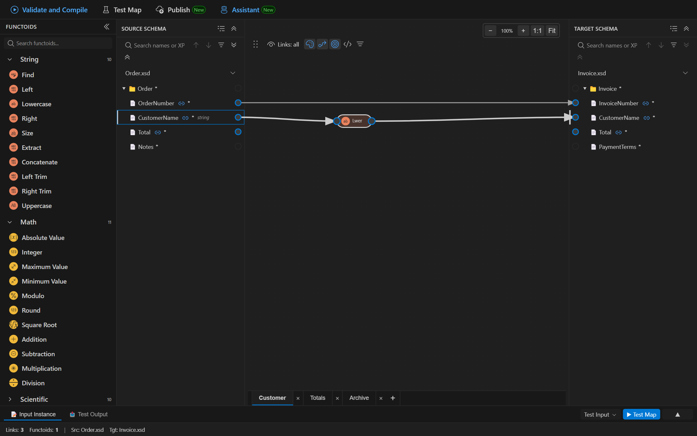

### Search Names and XPaths

Use **Search names or XPaths** in either tree. Matching is case-insensitive and includes attribute paths. The search shows match counts and a no-results state. **Previous match** and **Next match**, or Enter and Shift+Enter in the search field, move through matches and reveal collapsed or offscreen nodes. Use **Clear search** to remove the query.

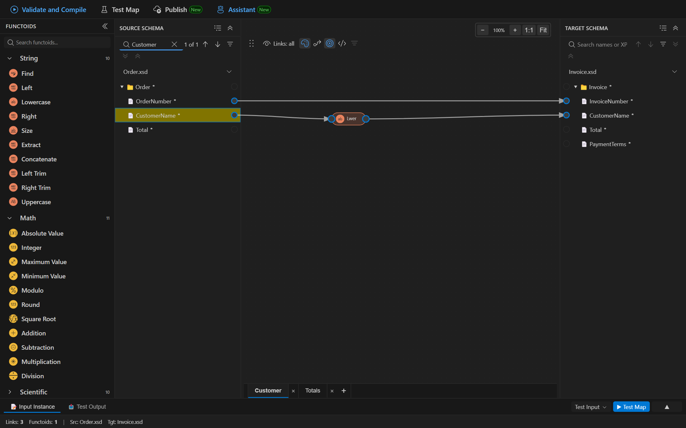

### Schema Node Context Menu

Right-click a node to open actions appropriate to that node and side:

| Action | Purpose |
| --- | --- |
| **Properties** | Inspect metadata and edit an eligible map-specific test or target value. |
| **Copy XPath** | Copies the node's XPath through the VS Code clipboard. |
| **Suggest Matches** | Ranks eligible nodes in the opposite schema and lets you reveal candidates. It does not create links automatically. |
| **Link from Here** | Starts a scoped branch-linking operation from a source node. Complete it on a target node as described under linking. |
| Expand/collapse subtree actions | Navigate only the selected branch. |
| **Show Related Mappings Only / Show All Mappings** | Isolates mappings associated with the selection, or restores the full mapping display. |

Selection, search highlighting, match suggestions, and related-mapping filtering are navigation aids, not changes to the XSD.

## Schema Node Properties

Double-click a node, use its **Properties** context action, or focus it and press Enter to open its properties. The dialog displays available metadata such as name, node kind, data type, namespace, XPath, occurrence constraints, schema defaults/fixed values, and description. Metadata varies with the selected node.

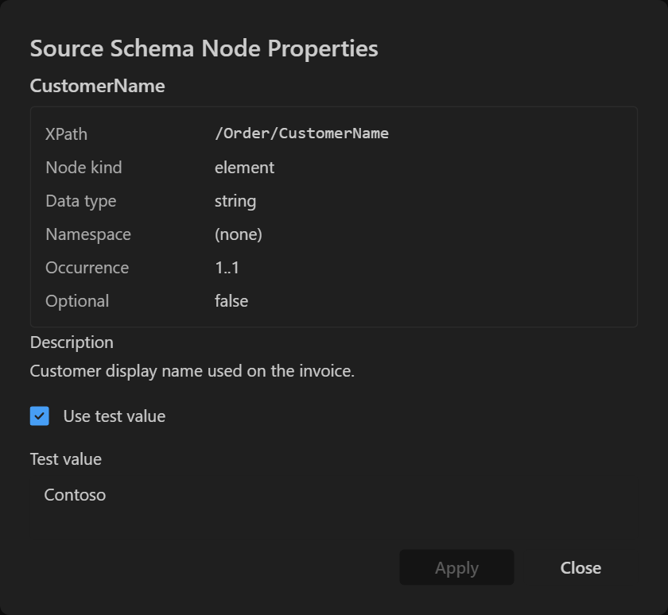

| Value editor | Effect |
| --- | --- |
| Source **Test value** | Supplies a map-specific value used when generating a sample input instance. It does not change the source XSD or the values in an uploaded XML file. |
| Target **Constant value** | Assigns a map-specific constant to an eligible output element or attribute. It does not change the target XSD. |
| **Use ...** checkbox | Enables an override. An enabled empty editor means an explicit empty value, not an unset override. Disable the checkbox and apply to remove the override. |
| **Apply** | Saves changed editable values. |
| **Close** | Closes the dialog; unapplied edits are discarded. Nodes with no editable values provide inspection only. |

Structural nodes and nodes that cannot occur are not value-editable. An incoming target link on any page prevents assigning a conflicting target constant; an existing override can still be cleared. A disabled editor explains why it cannot be changed. Removing an override leaves the schema's own default or fixed value intact.

## Canvas Navigation and Layout

### Pan, Zoom, and Position Items

- Drag empty canvas space to pan using hand-style movement, or use the scrollbars. The viewport cannot pan beyond the top-left origin.
- Drag a transformation component's body to move it. Its connectors are reserved for linking.
- Use **Zoom Out** and **Zoom In** to change canvas magnification from 10% to 200%. The percentage shows the current zoom, and **1:1** resets it to 100%.
- Zoom changes the view; it does not rewrite saved mapping coordinates. Palette clicks take the current zoom and scroll position into account.
- Use Shift, Ctrl, or Cmd with an empty-space drag for box selection rather than hand panning.

### Fit

**Fit** rearranges functoids on the active page into the current view without overlaps. It is an auto-layout operation, not a zoom-to-fit command. It changes map positions, so save the map if you want to keep the result. It does not change the intended mapping relationships.

Use Fit after importing a legacy map with overlapping or negative coordinates, or to make a crowded page readable. Switch pages and apply Fit separately where needed. It is disabled when there are no functoids to arrange. A dismissible layout helper can point out imported pages needing attention.

### Canvas Context Menu

Right-click empty canvas space to access mapping actions such as **Select All**, **Paste**, **Auto-Link by Name**, and **Properties** (which opens **Grid Properties**). Right-click a link or selected component for actions relevant to that selection, including properties, clipboard actions, deletion, and moving mappings to a page. Availability depends on the selection and clipboard contents.

## Create and Manage Links

### Draw a Link

Drag from one connector to another to connect a source node to a target node, a source node to a transformation input, a transformation output to a target node, or one transformation output to another input. You can also click connectors to start and complete a link. A preview follows the pointer while linking; Escape cancels an unfinished operation.

The editor validates the proposed connection. Missing endpoints, duplicate links, cycles, unavailable inputs, and ineligible target nodes can prevent a link. A visible connector is not a promise that every possible connection is valid. Target constants and fixed values can also affect eligibility.

### Link Branches and Auto-Link

For a scoped operation, right-click a source branch and choose **Link from Here**, then right-click the destination target branch and choose an available strategy:

| Strategy | Purpose |
| --- | --- |
| **Direct Link** | Connects the chosen endpoints directly. |
| **Link by Name** | Creates eligible child mappings by matching names within the selected branches. |
| **Link by Structure** | Pairs eligible children by their structural positions. Check the result carefully when schema orders differ. |
| **Mass Copy** | Creates a branch-copy mapping through the corresponding transformation component. |

The canvas **Auto-Link by Name** action operates on the map rather than a selected pair of branches. Duplicate or invalid links are not blindly added. Review generated mappings and test representative documents; name or position matches do not establish business equivalence.

### Change or Remove an Existing Link

Select a line to expose its endpoint handles. Drag the source or target handle to a new eligible connector, or use **Change link source** / **Change link target** from the context menu. Retargeting keeps the link's identity, label, and directives while updating endpoint references. Escape cancels; invalid replacements do not commit a partial link.

Delete a selected link with Delete or its context action. Deleting a component also removes its associated connections. Use [Link Properties](#link-properties) to change a line's label or copy/hierarchy directives without moving endpoints.

## Link Properties

Double-click a line, choose **Link Properties** from its context menu, or focus the link and press Enter or Space.

| Field | Purpose |
| --- | --- |
| **Label** | Optional text displayed on the mapping line. |
| **Link source** | Read-only description of the current source endpoint. |
| **Link target** | Read-only description of the current target endpoint. |
| **Source link directive** | Select **Value Copy**, **Name Copy**, or **Mixed Copy** to control what is copied from the source node. |
| **Target link directive** | Select **Flattening**, **Top Down**, or **Bottom Up** to control hierarchy handling for applicable mappings. |
| **OK** | Saves the changed fields. |
| **Cancel** or Escape | Discards unapplied changes. |

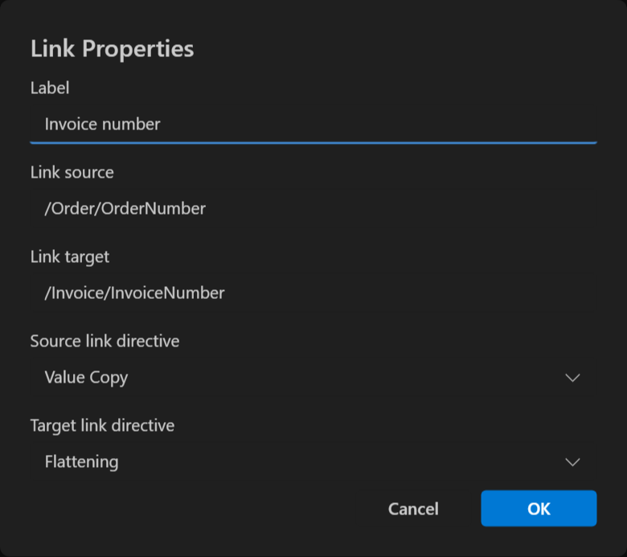

**Value Copy** is the ordinary source-value mapping. **Name Copy** uses the source node's name instead. **Mixed Copy** passes the source node selection rather than converting it to a text value; its effect depends on the consuming mapping. For applicable repeating contexts, **Top Down** chooses the outermost common repeating source path, while **Bottom Up** chooses the innermost. **Flattening** uses the default hierarchy handling. These are transformation directives, not canvas drawing or sorting options. Test nested/repeating data after changing them.

When multiple links are selected, the dialog indicates **Multiple values** for differing fields. Only fields you change are applied to all selected links; other per-link values are preserved.

## Links Toolbar

The floating **Links toolbar** controls how mappings are displayed, not which mappings are saved. Drag its dotted handle to move it within the canvas. With the handle focused, arrow keys move it; Shift plus an arrow makes finer adjustments.

| Control | Purpose |
| --- | --- |
| **Links: all** / **All links** | Shows links regardless of endpoint visibility. |
| **At least one endpoint visible** | Shows links with at least one endpoint in the visible schema area. |
| **Both endpoints visible** | Shows links only when both endpoints are visible. Collapsed and scrolled-out schema rows affect visibility. |
| **Dim partial links** | Dims and recolors lines whose endpoints are not both visible. |
| **Trace selection** | Highlights connected paths upstream and downstream from the selected node, link, or component. Selecting a record does not automatically include its child-node mappings. |
| **Auto-reveal selection** | Expands schema ancestors and scrolls selected mapping endpoints into view. Disable it if you want to keep the current tree position while selecting mappings. |
| **Compiler links** | Requests compilation and overlays dashed dependency links reported by the compiler. These are diagnostic, noneditable lines, not newly authored mappings. |
| **Related mappings only** | Hides unrelated links and components to isolate the selected mapping graph. Requires a relevant selection. Toggle it off to restore all mappings. |

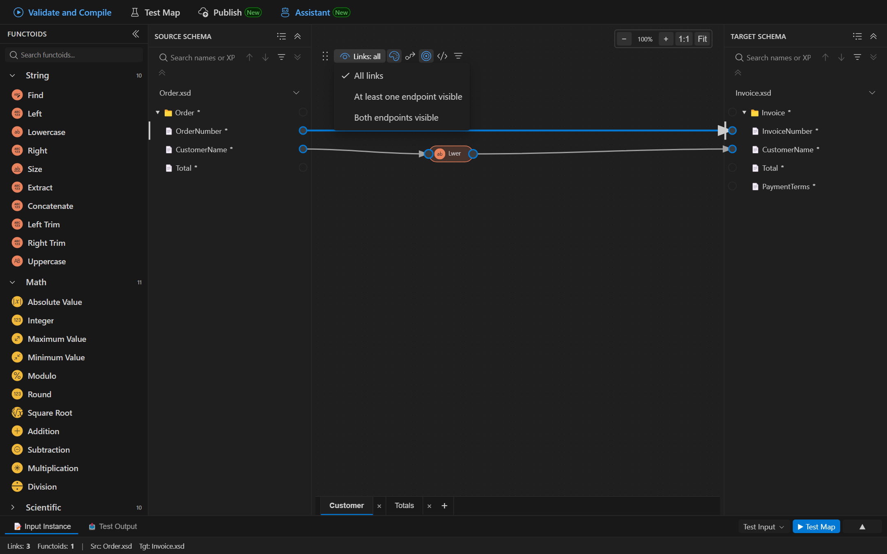

Compiler overlays are cleared when edits or schema changes make them stale. They do not infer every dependency hidden inside arbitrary custom XSLT or script code. If something appears missing, check the page, tree expansion, link scope, and related-mapping filter before recreating a link.

## Selection and Clipboard

Click a line or component to select it. Ctrl, Cmd, or Shift with a click toggles items in a multi-selection. Modifier-drag on empty canvas space selects intersecting lines and components. Clicking empty space clears the selection.

| Action | Shortcut | Scope and effect |
| --- | --- | --- |
| Select all | Ctrl/Cmd+A | Selects the current page's mapping items. |
| Copy | Ctrl/Cmd+C | Copies selected mapping items for reuse within the same map. |
| Cut | Ctrl/Cmd+X | Copies and removes the selection. |
| Paste | Ctrl/Cmd+V | Creates independent mapping items with new identifiers and validates their links. |
| Delete | Delete | Removes the selection and affected connections. |
| Cancel linking/retargeting | Escape | Abandons the unfinished connection operation. |

Clipboard operations preserve applicable link properties, component configuration, and ordered inputs. The mapper clipboard supports moving work across pages in the same map, not cross-map graph transfer. Ineligible pasted links can be skipped with a notification; review the result. Shortcuts inside text fields retain their normal text-editing behavior.

Use VS Code's document Undo/Redo actions to reverse or restore saved editor changes. For moving work rather than duplicating it, use **Move to Page**.

## Pages

Pages organize portions of a single map; they do not create independent transformations. Source and target schema selections and map-level settings belong to the map. Compilation combines page content, so changing a mapping on another page can affect the final output.

| Page-bar action | Purpose |
| --- | --- |
| Select a named tab | Switches the active canvas page. |
| **Add page** (+) | Adds a new page. |
| Double-click a page name | Renames it inline. Enter commits the name; Escape cancels. |
| **Delete page** (x) | Deletes that page; nonempty pages require confirmation. The last page cannot be deleted. |
| **Move to Page** in the selection menu | Moves mappings to an existing page or **New Page**. Connected components and related links are kept together to avoid dangling endpoints. |

Review the active page before using Select All, Delete, or Fit. To find a mapping that seems absent, inspect the other page tabs as well as display filters.

## Grid Properties

Right-click empty canvas space and choose **Properties** to open **Grid Properties** and edit map-level settings. Despite its name, this dialog is not the canvas zoom control and is not an individual component's input editor. **Apply** saves changes; **Cancel** discards the draft.

### General

| Field | Purpose |
| --- | --- |
| **Ignore Namespaces for Links** | Controls whether namespace differences are ignored while matching schema paths for links. Use cautiously with schemas containing similarly named nodes in different namespaces. |
| **Script Type Precedence** | Enables/disables script implementations and orders preference using Move up/Move down. It does not rearrange canvas items. |
| **Source Schema / Target Schema** | Read-only references, or an inline-schema indication. Use the schema panes to replace a schema. |

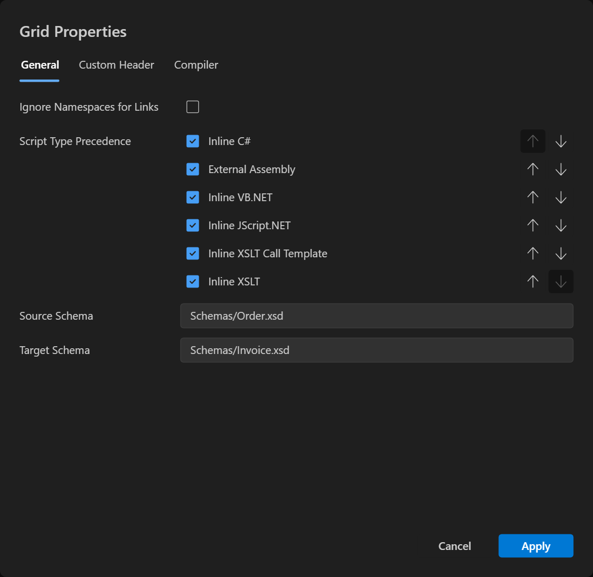

### Custom Header

These settings describe generated XSLT output. Their effect depends on the output method and transformation engine; they do not change the source schema.

| Field | Purpose |
| --- | --- |
| **XsltEncoding** | Selects an output encoding, including Unset, UTF-8, UTF-16 variants, US-ASCII, ISO-8859-1, or **Custom**. |
| **Custom encoding** | Supplies the encoding name when Custom is selected. |
| **Method** | Chooses `xml`, `html`, or `text` output. |
| **Copy PIs** | Controls copying processing instructions. |
| **Version** | Selects the XSLT version, 1.0 or 2.0. Engine compatibility still applies. |
| **Standalone** | Leaves the standalone declaration unset, or requests Yes/No. |
| **Doctype public / Doctype system** | Supplies document-type identifiers when required. |
| **CDATA section elements** | Specifies output elements whose content should use CDATA sections. |
| **Indent** | Leaves indentation unset, or requests Yes/No. |
| **Media-Type** | Supplies the output media type. |
| **Omit XML Declaration** | Suppresses the XML declaration when applicable. |

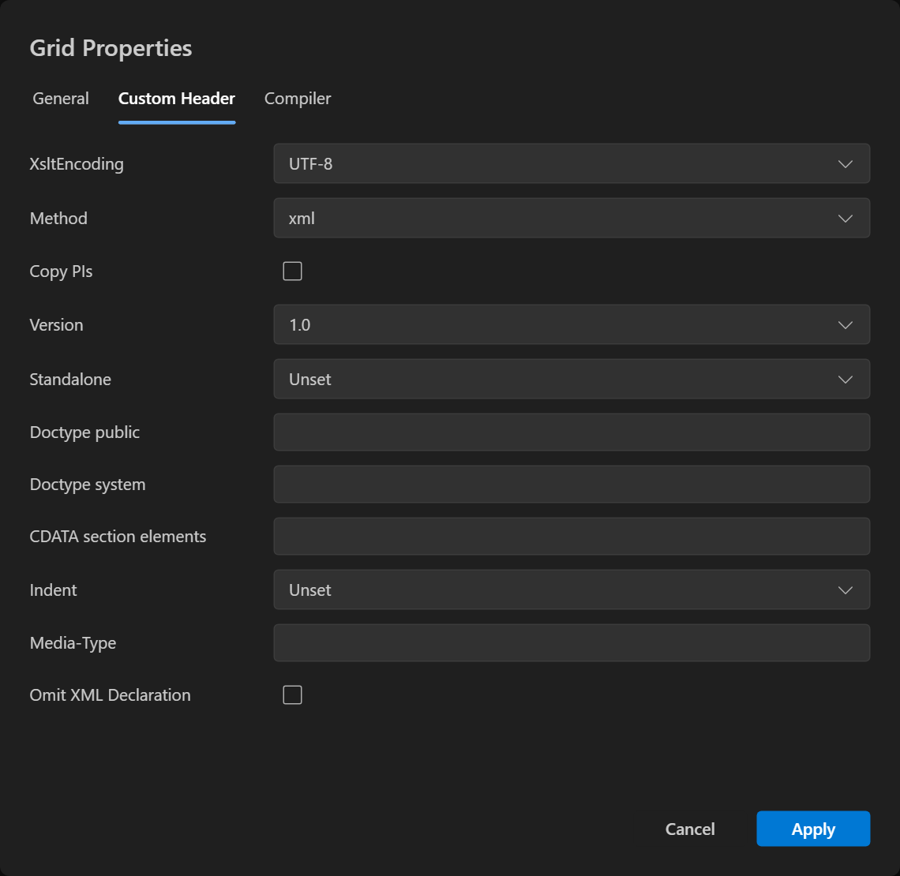

### Compiler

| Field | Purpose |
| --- | --- |
| **Custom XSLT Path** | References a custom stylesheet used instead of the generated visual mapping stylesheet. Keep it with the project and verify its dependencies. |
| **Custom Extension XML path** | References extension-object configuration used with custom assembly calls. |
| **XSLT transform engine** | Selects .Net Framework or leaves the setting unset (blank); imported values can also be displayed. |
| **Use XSL Transform** | Selects Yes or No, or leaves the setting unset (blank), when .Net Framework is selected. |

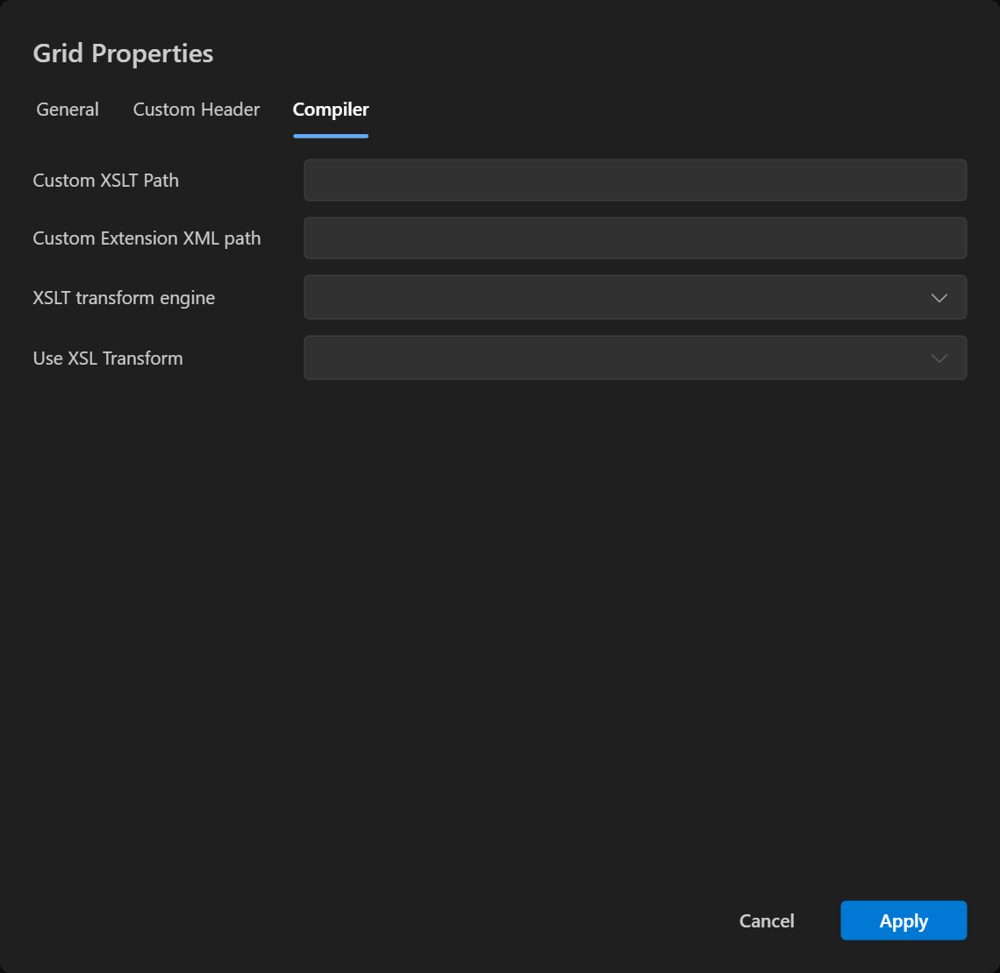

An imported engine setting does not install an engine or make every legacy engine/component available. The runtime shipped with the extension determines what can execute. Validate and test after changing compiler settings or custom artifacts.

## Assistant

Select **Assistant** on the main toolbar to open its panel. Describe the mapping change you want, such as connecting fields, setting constants, organizing pages, or rearranging the current layout.

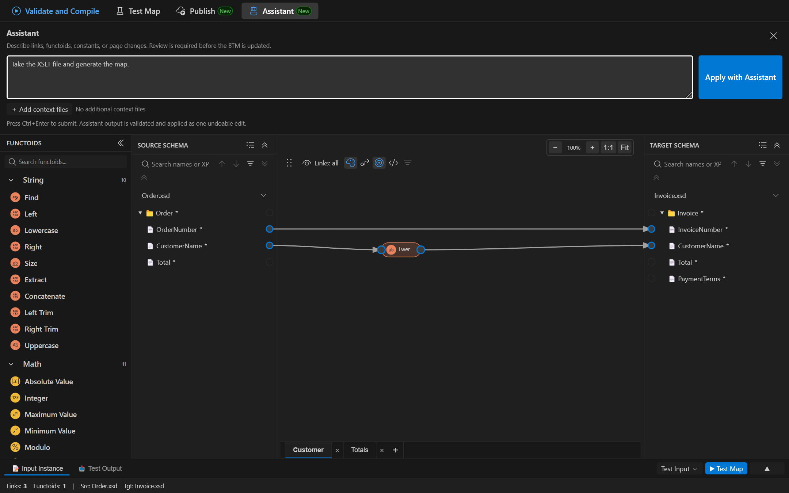

| Control or behavior | Purpose |
| --- | --- |
| Prompt editor | Describe the requested change. Be specific about page, source/target paths, and expected result. |
| **Apply with Assistant** | Sends the request to an available VS Code language model. Ctrl+Enter also submits. |
| **Add context files** | Attaches reference material such as XSLT, schema information, or extension-object configuration to help explain an existing transformation. |
| Remove a file / **Clear all** | Removes one or all additional context files from the request. |
| Review and **Apply Changes** | Lets you accept or reject proposed changes after validation, before the BTM document is updated. |
| Close | Hides the Assistant panel. |

Model availability, authentication, and access are controlled by VS Code and your configured model provider. Context files are included in the model request; do not attach secrets or sensitive data you are not permitted to share. Files are limited to 512 KB each and 2 MB in total; binary files are skipped.

Assistant output is validated before application and is applied as one undoable document edit. Requests can be rejected when changes are invalid or the document changed while a response was being prepared. Very large maps can be limited to layout requests. Assistant output is a proposal, not proof of correct business logic: review, compile, and test it.

## Validate and Compile

Choose **Validate and Compile** on the main toolbar to check the map and generate XSLT. Review reported errors and warnings, including page-qualified diagnostics where available. A successful compile writes generated artifacts under `__generated`, normally including `<map-name>.xslt`; required extension-object metadata can accompany custom assembly mappings.

Compilation evaluates the combined map, including its pages, schema paths, connection rules, component inputs, and applicable target rules. An unlinked or invalid mapping, unresolved schema, or unavailable custom dependency can prevent success. Compilation is not a substitute for testing the transformation with realistic data.

## Test Input and Test Map

### Prepare Input

Expand the bottom panel and select **Input Instance**. Its editor contains the XML that Test Map will use.

| Control | Purpose |
| --- | --- |
| **Test Input > Upload input file** | Loads an XML file into Input Instance. Canceling the picker leaves the current input unchanged. |
| **Test Input > Generate instance** | Creates sample XML from the source schema and applicable source-node test values. |
| Input editor | Lets you type, paste, or modify XML before testing. |
| **Input Instance / Test Output** tabs | Switch between the input document and test results. |
| Collapse/expand button | Changes the bottom panel's visibility without removing the map. |

Uploading or generating input does not run the map by itself. A generated instance is a starting point, not comprehensive test coverage: change repeating records, optional elements, choices, empty values, and other cases relevant to your data.

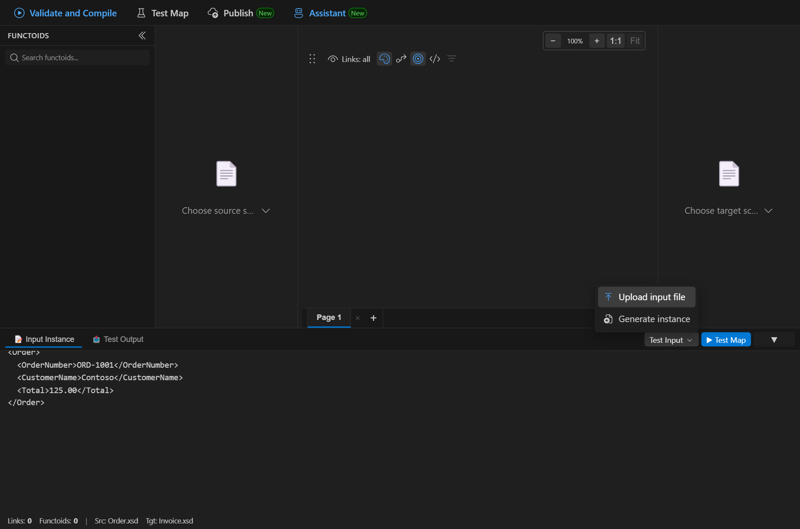

### Run and Inspect Results

Choose **Test Map** on the main toolbar or in the bottom panel. The current map is compiled automatically before the transformation; a separate compile is not required. Outside the tutorial, an empty input can trigger sample-instance generation before execution. During the tutorial, enter or load input before the testing step.

Compilation or transformation failure leaves an error to inspect and does not establish a successful map. Correct the reported problem and rerun. On success, inspect **Test Output** and the generated document, normally `__generated/<map-name>_output.xml`.

XML output is formatted for readability; text and HTML outputs retain their format. Repeated runs refresh the same generated document and reuse its editor tab. Save or discard unsaved edits in a previous output document before rerunning. The output is not automatically validated against the target XSD: compare it with expected results and validate it separately when your workflow requires schema conformance.

## Publish

Select **Publish** to open **Publish Data Map**. Publishing requires a trusted workspace and compiles the map again; it is not started by creating a project, importing a map, or reaching the last tutorial helper.

### Local Workspace

1. Choose **Local Workspace**.
2. Select the destination **Logic Apps project** from eligible projects in the open workspace.
3. Review **Publishing destination**, including the workspace, project, artifacts path, and source map.
4. Select **Publish** and confirm any overwrite prompt for the compiled map.

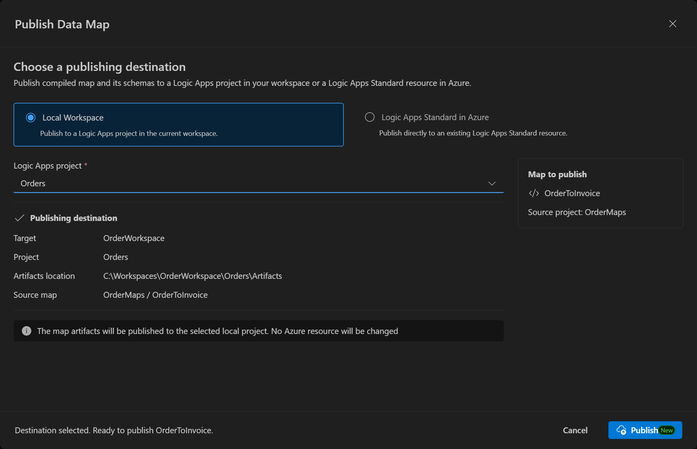

If no eligible Logic App project is found, add or open one first. Local publishing prepares runtime artifacts in that project; it does not change Azure or deploy the Logic App.

### Logic Apps Standard in Azure

1. Choose **Logic Apps Standard in Azure** and sign in when prompted.
2. Select **Subscription**, **Resource group**, and **Logic App (Standard)**. Use the lists' search controls as needed.
3. Review the destination and select **Publish**.
4. Confirm any overwrite prompt only after checking that this is the intended environment.

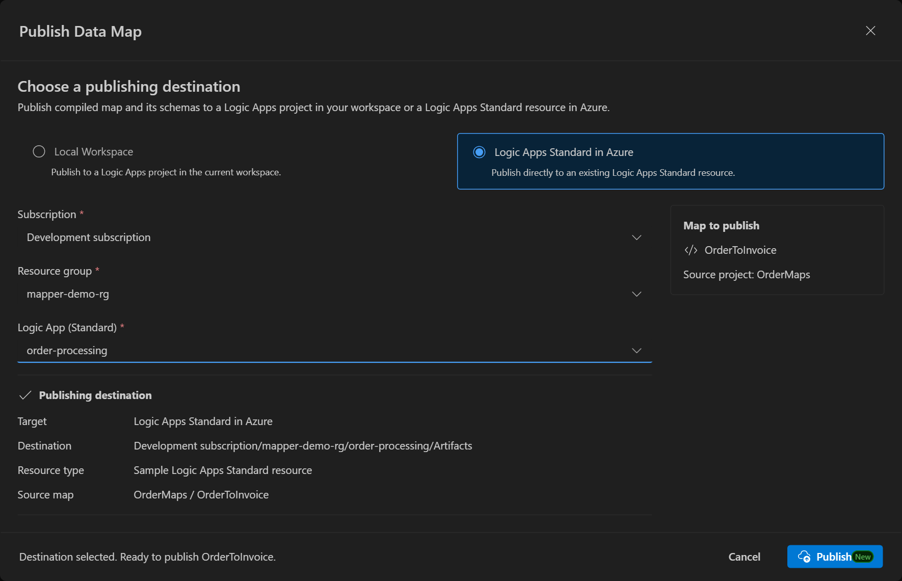

Azure publishing updates artifacts in the selected existing Logic App directly. It does not create an Azure resource or deploy the whole workspace, and it can affect workflows that use the published map. Your account needs permission to update that resource.

### Published Artifacts

| Artifact | Destination relative to the Logic App root |
| --- | --- |
| Compiled map | `Artifacts/Maps/<map-name>.xslt` |
| Referenced schemas and schema dependencies | `Artifacts/Schemas/`, preserving the publishing plan's relative paths |
| Required custom assemblies | `lib/custom/net472/<assembly-name>.dll` |

The source `.btm`, tutorial state, and Test Map input/output are authoring/testing material, not published runtime artifacts. Existing compiled maps require overwrite confirmation. Existing destination schemas and assemblies are kept rather than silently overwritten; review dependency versions separately when they need updating. Resolve missing dependencies before publishing and verify the resulting workflow in the destination environment.

## Save and Troubleshoot

Save the `.btm` with the normal VS Code Save action. Canvas layout changes, page operations, properties, and accepted Assistant edits can change the document. Keep the map, schemas, and custom dependencies together; `__generated` contains derived output rather than the only copy of your map.

| Symptom | Check |
| --- | --- |
| A schema cannot be loaded | Review the displayed path/error, select the correct XSD and root, and restore imported/included schema dependencies. |
| A link or component appears missing | Check the active page, scroll position, collapsed schema branches, link scope, and Related mappings only filter. Use tracing and auto-reveal. |
| Imported components overlap or sit offscreen | Use Fit on the affected page; review and save the changed layout. |
| A connection is rejected | Check direction, duplicate links, cycles, input limits, target constants/fixed values, and node eligibility. |
| A value editor is disabled | Read its reason. A structural node or linked target may not accept a constant override. |
| Compilation or Test Map fails | Read the error/output, check schema references and custom dependencies, correct input XML, and retry. |
| Assistant is unavailable or rejects a change | Check model access, request size, validation feedback, and whether the document changed during the request. |
| Publish has no local target | Include an eligible Logic App project in the workspace. A mapper project alone is not a runtime Logic App. |

For workspace setup and folder conversion, see the [Workspace and Data Mapper Upgrade Guide](workspace-and-mapper-upgrade.md). For extension prerequisites and general workflows, see the [Standard extension overview](../../README.md).