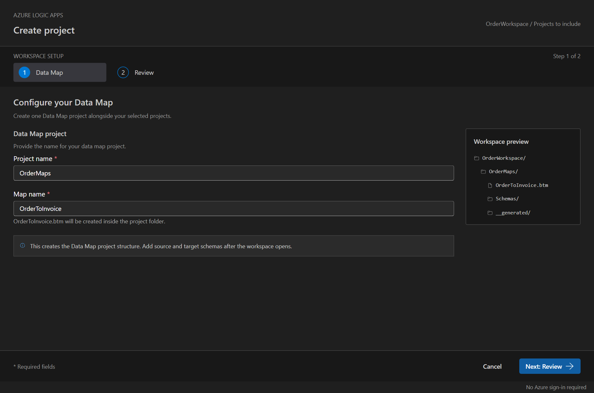
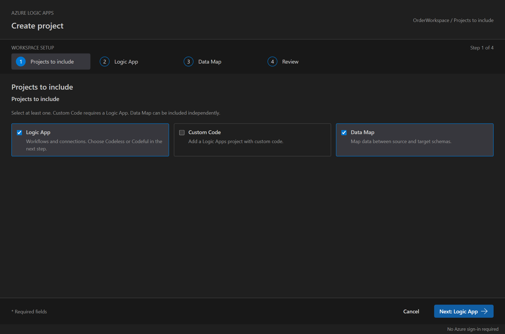
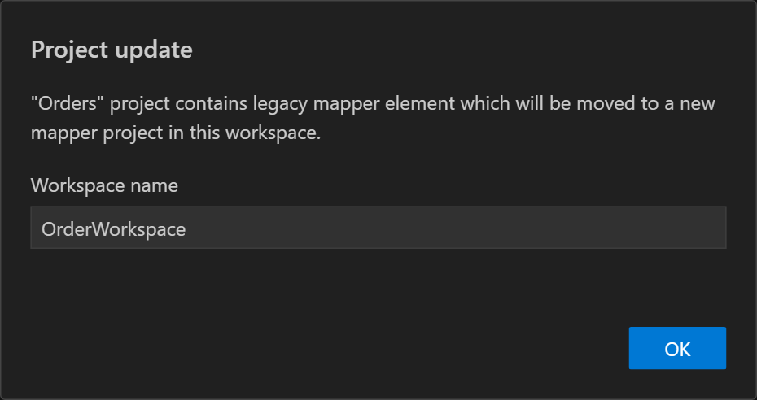
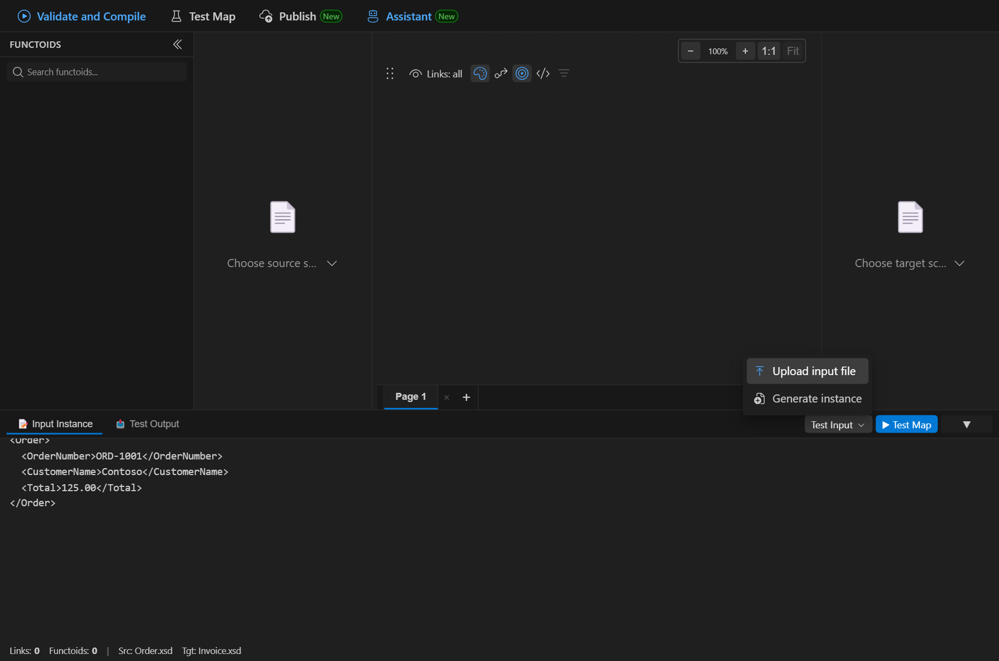

# Workspace and Data Mapper Upgrade Guide

The Azure Logic Apps (Standard) extension includes a workspace setup experience and an integrated Data Mapper. This guide describes the changed menus, mapper project layout, and conversion of existing projects.

The screenshots show the extension webviews with sample project names and data. Colors can vary with your VS Code theme.

For the complete current mapper UI reference, tutorial, and legacy BizTalk map import steps, see [BTM Data Map](btm-data-map.md). This guide focuses on workspace setup and upgrading existing project layouts.

## Before You Upgrade

- Commit or back up your workspace, including map definitions, schemas, custom mapper assets, metadata, and the `.code-workspace` file.
- Save open mapper files before accepting conversion.
- Open a trusted local workspace. Conversion is not performed in an untrusted workspace or a workspace containing non-local folders.
- Review build scripts, source-control rules, and documentation that reference `Artifacts/MapDefinitions`, `Artifacts/DataMapper`, or the old mapper metadata paths.

> **Important:** Data Mapper is now a separate workspace project. It is not a separate Azure resource, and you do not need to install or activate another Data Mapper extension. Creating or converting a mapper project does not deploy its maps to a Logic App.

## Create or Extend a Workspace

In the Azure view, find **Workspace**, open the **Azure Logic Apps** menu, and choose **Create Project**. You can also use **Create Project** from the Explorer context menu on a workspace root or empty Explorer area.

| Menu option | Forms shown |
| --- | --- |
| **Add mapper** | Data Map, then Review. |
| **Add custom code** | Custom Code, then Review when the workspace already contains a Logic App. If there is no Logic App, its configuration form is included too. |
| **Add Logic App** | Logic App, then Review. |
| **Open wizard** | Projects to include, the selected project forms, then Review. |

The project-specific shortcuts do not show **Projects to include**. If no workspace or folder is open, they also collect the new workspace's name and location. **Create new logic app workspace...** opens the full workspace creation experience.

**Add mapper** opens directly at Data Map configuration. The preview shows the new mapper folder and its initial `.btm` map.



**Open wizard** keeps the project chooser, so you can select the combination of projects to add.



For **Add custom code**, an existing target must support custom code: SDK-based Logic Apps and apps that already have an associated custom-code project are not eligible for another association. When multiple eligible Logic Apps exist, select the target when prompted. If none are eligible, use the existing code project or open the full wizard to create another Logic App.

## Mapper Project Layout

For example, a workspace with a Logic App and a mapper project has this layout:

```text
OrderWorkspace/
  OrderWorkspace.code-workspace
  Orders/
    host.json
    ProcessOrder/
      workflow.json
    Artifacts/
      Maps/
      Schemas/
  OrderMaps/
    OrderToInvoice.btm
    Schemas/
      Order.xsd
      Invoice.xsd
    __generated/
```

The `.code-workspace` file includes `Orders` and `OrderMaps` as separate folders. Map definitions live at the mapper project root. Source and target schemas live under the mapper project's `Schemas` folder. Compilation and Test Map create output under `__generated`.

Imported maps can also have an `Artifacts` folder for their dependencies. Do not remove referenced custom stylesheets, extension descriptors, or assemblies when moving a map.

Within a recognized mapper project, use **Add new map...** to create a map or **Import data map...** to bring in an existing map. The import action and legacy-workspace conversion are different operations: importing can copy dependencies and adjust references, while legacy conversion relocates existing files without changing their contents.

### Map Formats

- Newly created maps use `.btm` and open in the bundled visual mapper.
- Existing `.lml` maps continue to open in the LML editor.
- Workspace conversion does not translate between `.lml` and `.btm`. A relocated `.lml` map remains `.lml`.

## Open an Existing Project

The extension checks for legacy mapper elements when it activates, when workspace folders change, and when workspace trust is granted. Detection includes `Artifacts/MapDefinitions`, `Artifacts/DataMapper`, and supported v2 mapper metadata files in the Logic App's `.vscode` folder.

The **Project update** prompt asks for confirmation before moving files. The workspace-name field is shown only when a saved workspace file is needed.



1. Open the existing local Logic App folder or its saved `.code-workspace` file.
2. Grant workspace trust only if you trust the project contents.
3. Read the **Project update** prompt. Opening a project alone does not start moving files: choose **OK** to begin conversion.
4. If there is no saved workspace file, enter a valid, unused workspace name when prompted. The extension creates a `.code-workspace` file in the parent directory of the Logic App project.
5. Wait for conversion to complete. Select **Close** on the completion screen. If a workspace file was created, the extension opens it.
6. Confirm that the mapper project appears as a separate workspace folder, open a map, and review source and target schema references.
7. Review the file moves in source control and update any build or packaging scripts that use the old locations.

The mapper project is named after the Logic App, such as `OrdersMapper`. If that directory already exists, the extension selects an unused name such as `OrdersMapper1`; it does not overwrite that directory.

### What Conversion Changes

| Existing location in the Logic App | Mapper project location | Original after successful conversion |
| --- | --- | --- |
| `Artifacts/MapDefinitions/*` | Mapper project root, preserving subfolders | The legacy `MapDefinitions` folder is removed. |
| `Artifacts/DataMapper/*` | `Artifacts/DataMapper/*` | The legacy `DataMapper` folder is removed. |
| `Artifacts/Schemas/*` | `Schemas/*` | Original schemas remain in the Logic App. |
| Supported `*mapmetadata-v2.json` files in `.vscode` | `.vscode`, with the same filenames | Converted metadata files are removed from the Logic App. |

The extension copies and verifies file contents before removing the converted legacy mapper elements. Cleanup requests use VS Code's trash option. Existing compiled maps in the Logic App's `Artifacts/Maps` are not moved by this conversion.

This is a workspace/file-layout migration, not a map-language conversion. It does not publish maps, update your CI pipeline, or prove that a map produces the expected business result. Review and verify your maps before deploying them.

### Defer or Recover From Conversion

- To defer, close the **Project update** editor tab before choosing **OK**. Reload the VS Code window when you are ready to be prompted again.
- Save dirty mapper documents before retrying. Conversion rejects linked files and directories and stops if source files change during conversion.
- If conversion fails before the new project is registered, incomplete conversion files are cleaned up and the original files remain.
- If an error reports that converted files were preserved, inspect the reported mapper directory and the original folders before deleting anything. Registration may have completed even if cleanup failed.
- To return to the previous layout, use your source-control revision or backup and restore the corresponding workspace configuration. Do not delete the mapper project until its contents are accounted for.

## Create a Sample Map

Open a new or empty `.btm` map in a trusted mapper project. The canvas shows a dismissible **Start Tutorial** callout with a link to this guide. Opening a map does not create sample files.

1. Select **Start Tutorial**. The extension adds sample input and output schemas to the mapper project's `Schemas` folder. Existing schemas are not overwritten; conflicting sample names receive an unused filename.
2. In the source schema dropdown, select the offered `TutorialInput.xsd` sample, or its numbered filename.
3. In the target schema dropdown, select the offered `TutorialOutput.xsd` sample, or its numbered filename.
4. Select the highlighted **Lowercase** functoid in the **String** category to add it to the canvas.
5. Draw a line from the source **Name** string connector to the input connector on the left of **Lowercase**.
6. Draw a line from the output connector on the right of **Lowercase** to the target **Name** string connector.
7. Open **Test Input** to upload XML or generate an instance. You can also enter XML in **Input Instance**, for example:

   ```xml
   <TutorialInput>
     <Name>Ada LOVELACE</Name>
   </TutorialInput>
   ```

8. Select the highlighted **Test Map** button. After a successful run, the output contains `<Name>ada lovelace</Name>`. If the run fails, correct the input or reported error and retry.
9. The final helper highlights **Publish**. Continue with [Publish Mapper Artifacts](#publish-mapper-artifacts) to choose a local or Azure destination. The tutorial does not publish automatically.

Callouts advance when you complete each action; there is no **Next** button. During the tutorial, editing is limited to the highlighted actions and required connections. Dismiss the callout at any time to return to normal editing. Sample files and completed mapping work remain in the project. Normal editing is also restored at the final Publish helper.

## Test a BTM Map

These changes apply to the bundled `.btm` mapper. The `.lml` editor has its own controls and runtime.

1. Open the map and configure the source and target schemas and mapping links.
2. In the lower panel, open **Test Input**.
3. Choose **Upload input file** to select an XML file, or **Generate instance** to create sample XML from the source schema. Uploading replaces the Input Instance editor contents; canceling the file picker leaves them unchanged. Neither action runs the transformation by itself.
4. Edit the XML in **Input Instance** as needed, then select **Test Map**.



Each Test Map run compiles the current map and transforms the current input. You do not need to run Compile separately. If the input is empty, the mapper generates a sample instance first. Compilation failure stops the transformation.

XML output is automatically formatted before it is saved and displayed. Text and HTML outputs retain their output format. The generated output file uses the map name, such as `__generated/OrderToInvoice_output.xml`.

Repeated runs refresh the same output document and reuse its existing tab group rather than opening another copy. Focus stays on the mapper. Save or discard any unsaved edits in the generated output file before rerunning Test Map. Duplicate output tabs opened before this behavior change can be closed manually.

## Navigate the BTM Canvas

Click and drag empty canvas space to pan. The content follows your hand, as in the Logic Apps designer: dragging down scrolls the viewport up; dragging right scrolls it left. The canvas cannot scroll beyond its top-left origin.

Use Shift, Ctrl, or Cmd with an empty-space drag for box selection. Dragging a functoid still moves the functoid, and dragging a connector still creates or changes a mapping link. Scrollbars remain available.

## Publish Mapper Artifacts

The mapper project keeps authoring files separate from the Logic App's runtime artifacts. For a `.btm` map, select **Publish** in the mapper editor to open **Publish Data Map** and choose where its runtime artifacts should go. You can publish to a local project or directly to Azure without moving the mapper project into the Logic App.

| Publishing destination | What it does |
| --- | --- |
| **Local Workspace** | Copies artifacts into a Logic App project in the current workspace. No Azure resource is changed. |
| **Logic Apps Standard in Azure** | Uploads artifacts directly to an existing Logic Apps Standard resource selected by subscription, resource group, and app. |

Publishing requires a trusted workspace. Each publish compiles the current map; you do not need to run Compile separately. Compilation errors or unresolved schema dependencies stop publishing. Creating or converting a mapper project does not publish its artifacts.

### Publish to a Local Project

1. Include the target Logic App project in the current workspace, alongside the mapper project.
2. Open the `.btm` map and select **Publish**.
3. Choose **Local Workspace**, then select the target under **Logic Apps project**. You can search the project list.
4. Review **Publishing destination**, including the workspace, project, artifacts location, and source map.
5. Select **Publish** and confirm **Overwrite** if prompted to replace an existing compiled map.

If no Logic App project is detected in the workspace, **Local Workspace** is unavailable. Add or open the target Logic App project first. Publishing locally prepares that project's artifacts for local use and subsequent deployment; it does not deploy the project to Azure.

### Publish Directly to Azure

1. Open the `.btm` map and select **Publish**.
2. Choose **Logic Apps Standard in Azure**. Sign in when prompted, using an account with permission to update the target resource.
3. Select **Subscription**, then **Resource group**, then **Logic App (Standard)**. Each list supports searching.
4. Review **Publishing destination** and the source map before continuing.
5. Select **Publish** and confirm **Overwrite** if prompted to replace an existing compiled map.

> **Important:** Azure publishing changes artifacts in the deployed Logic App directly and can affect workflows that use them. It does not create an Azure resource or deploy the entire workspace. Choose the intended environment before publishing.

### Published Files and Overwrites

Both destinations use these paths relative to the target Logic App's application root:

| Artifact | Target location |
| --- | --- |
| Compiled map | `Artifacts/Maps/<map-name>.xslt` |
| Referenced schemas and their schema dependencies | `Artifacts/Schemas/`, preserving the planned relative paths |
| Required custom assemblies reported by compilation | `lib/custom/net472/<assembly-name>.dll` |

The compiled XSLT is also saved under `__generated` beside the source map. The `.btm` authoring file and Test Map input/output are not published as runtime artifacts.

An existing compiled map requires overwrite confirmation. Existing schema and assembly files at the destination are kept rather than overwritten; review and update those dependencies separately when their contents change. Review the destination files after publishing, especially when reusing schema or assembly filenames.

Keep the mapper project in source control with its schemas and required custom dependencies. Review ignore rules for generated test output and any changed build paths. Never assume a generated sample XML instance or a successful compilation verifies the business correctness of the transformation.

## Related Documentation

- [Azure Logic Apps (Standard) extension overview](../../README.md)
- [Create a Standard logic app workflow in Visual Studio Code](https://go.microsoft.com/fwlink/?linkid=2222287)
- [Azure Logic Apps issues and feedback](https://github.com/Azure/LogicAppsUX/issues)