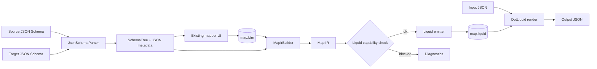
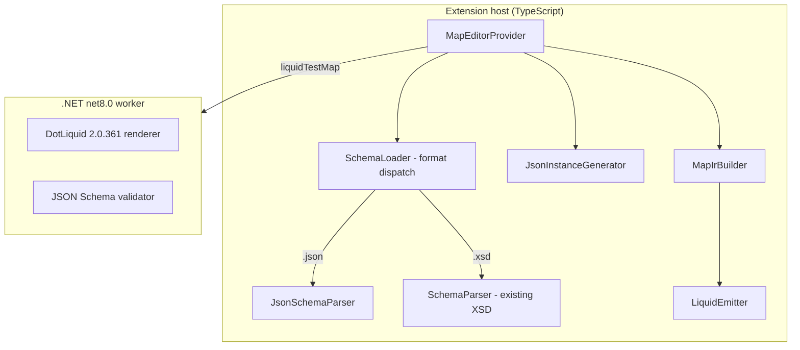

# JSON-to-JSON Mapping Design (JSON Schema → BTM → Liquid)

Status: Draft for review
Scope: `libs/data-mapper-v3` (Logic App Data Mapper VSIX)

## 1. Summary

Add JSON-to-JSON mapping to the BTM-based mapper. Generated output is a
**Liquid template** (`.liquid`), not XSLT, and nothing is converted between
JSON and XML at run time.

1. Users upload a **JSON Schema** for the source and target, just as they
   upload an XSD today.
2. A `JsonSchemaParser` builds the existing `SchemaTree` **directly from the
   JSON Schema**. No XSD is generated. Each node carries its JSON path and type.
3. Users author links and functoids in the existing mapper UI. The map is
   saved as a normal BTM file.
4. On compile, a backend-neutral **Map IR** is built from the BTM and the
   schema trees. A **Liquid emitter** turns that IR into `<map>.liquid`.
5. Test Map renders the template with **DotLiquid**, the engine that Logic Apps
   uses, on the raw JSON input and produces JSON output.
6. Deploy uploads `<map>.liquid` to `Artifacts/Maps`, where the Logic Apps
   **Transform JSON to JSON** (Liquid) action uses it.



XSD/XML maps are unaffected and keep using the existing XSLT compiler. This
design adds a separate path for maps whose source and target are both JSON
Schemas. It does not modify the XSLT path.

## 2. Goals and non-goals

### Goals

- Accept JSON Schema files (`.json`, `.schema.json`) for both source and
  target.
- Reuse the mapper UI, link model, functoid palette, and BTM file format.
- Emit a Liquid template that runs unmodified in the Logic Apps
  Transform JSON to JSON action, which uses DotLiquid.
- Make Test Map output exactly what Logic Apps would produce, by using the
  same engine and version.
- Report up front any functoid or link pattern that Liquid cannot express,
  rather than emitting a wrong template.

### Non-goals (first release)

- Mixed JSON↔XML maps, such as a JSON source with an XSD target or the
  reverse. These stay on the existing XSD/XSLT path. Liquid's XML-to-JSON
  support is a possible follow-up (§14).
- Converting between JSON and XML at run time. Nothing is converted.
- Generating Liquid from XSD-based maps.
- Schemaless mapping or schema inference from a sample. Both are possible
  follow-ups (§14).
- Scripting functoids (C#/VB/JS/XSLT), database functoids, and other
  constructs that Liquid in Logic Apps cannot run.

## 3. Current architecture (relevant parts)

| Concern | Today | File |
| --- | --- | --- |
| Schema model | `SchemaTree` / `SchemaNode` (XSD-shaped) | `src/model/schemaModel.ts` |
| Schema load | `MapEditorProvider.loadSchemaTree` → `SchemaParser.parseWithImports` | `src/mapEditorProvider.ts` |
| Schema picker | `showOpenDialog` filtered to `xsd` | `src/mapEditorProvider.ts` |
| Workspace schemas | `Schemas/*.xsd` listing | `src/workspaceStructure.ts` |
| BTM schema ref | `<SrcTree RootNode_Name><Reference Location/>` | `src/schema/btmSerializer.ts` |
| Compiler | `MapDocument + SchemaTree → XSLT` | `src/compiler/xsltCompiler.ts` |
| Worker | .NET net8.0 worker, line-delimited JSON on stdio | `tools/compiler-worker/*`, `src/worker/*` |
| Test Map | compile → transform → `__generated/<map>_output.xml` | `src/mapEditorProvider.ts` |
| Deploy | upload to `Artifacts/Maps` | `src/mapEditorProvider.ts` |

The UI and BTM layer only need a `SchemaTree` with stable node paths. They do
not depend on the tree having come from an XSD, so a JSON Schema can feed them
directly.

## 4. Schema model: JSON Schema → SchemaTree (design time only)

### 4.1 Mapping rules

| JSON Schema construct | SchemaTree node | Liquid addressing |
| --- | --- | --- |
| Root `object` | record node `R` (root) | `content` |
| Root `array` of `T` | `R` → repeating `Item` record | `` |
| `properties.p` (object) | child record `p`; order follows the schema | `x.p` |
| `properties.p` (array of `T`) | repeating node `p` (`maxOccurs = unbounded`) | `` |
| array of arrays | `p` (repeating) → `Item` (repeating) | nested `for` |
| `string` / `format` | field, `dataType = string` (`dateTime`, `date`, `uuid`, …) | `x.p` (quoted) |
| `integer` / `number` | field, `dataType = integer/decimal` | `x.p` (unquoted) |
| `boolean` | field, `dataType = boolean` | `x.p` (unquoted) |
| `type: [T, "null"]` | `nullable` flag | `null…` |
| not in `required` | `minOccurs = 0` | guarded by `` |
| `enum` / `const` | `restrictions.enumeration` | — |
| `$ref` / `$defs` / `definitions` | expanded lazily, with recursion guarded like XSD | — |
| `allOf` | merged properties | — |
| `oneOf` / `anyOf` | `choiceGroup` branches | `if` on a discriminator, or property existence |
| `additionalProperties` / `patternProperties` | wildcard node, not linkable (warning) | Mass Copy only (§10, `additionalProperties` row) |

Property names are shown and stored **unchanged** (`first name`, `@id`,
`$type`). BTM paths escape only the path separator characters `/`, `[` and
`]` (§6). Liquid accesses names that are not identifiers with bracket
notation: `x["first name"]`.

The root name `R` is the schema `title`. If there is no title, it is the file
name stem. It is persisted as `RootNode_Name`.

### 4.2 JSON metadata on schema nodes

```ts
// src/model/schemaModel.ts (additive, optional)
export interface SchemaTree {
  // …existing
  sourceFormat?: 'xsd' | 'jsonSchema';   // absent ⇒ 'xsd'
  jsonSchemaDialect?: string;             // $schema URI
}

export interface SchemaNode {
  // …existing
  json?: JsonNodeInfo;
}

export interface JsonNodeInfo {
  pointer: string;        // JSON Pointer into the schema: "/properties/items/items"
  propertyName: string;   // exact JSON property name
  accessPath: string[];   // segments from the nearest loop scope or root, for Liquid access
  jsonType: 'object' | 'array' | 'string' | 'number' | 'integer' | 'boolean' | 'null';
  nullable: boolean;
  required: boolean;
  isArrayItem: boolean;
  arrayDepth?: number;
  format?: string;
  choiceBranch?: string;
}
```

Existing XSD trees omit `json`, so all current behavior is unchanged.

## 5. Components



| Component | Location | Responsibility |
| --- | --- | --- |
| `SchemaLoader` | `src/schema/schemaLoader.ts` | Chooses the XSD or JSON Schema parser. It decides from the BTM `Format` attribute, then the file extension, then by checking the content. The extension and the worker compiler host both use it. |
| `JsonSchemaParser` | `src/schema/json/jsonSchemaParser.ts` | Builds a `SchemaTree` with `json` metadata. It resolves `$ref` files under `Schemas/`, supports drafts 4 through 2020-12, and reports lossy constructs as diagnostics. Its output is deterministic. |
| `JsonInstanceGenerator` | `src/schema/json/jsonInstanceGenerator.ts` | Generates a sample JSON input for **Generate Instance**, using `examples`, `default` and `enum` values, then format-aware samples. |
| `MapIrBuilder` | `src/compiler/ir/mapIrBuilder.ts` | Converts `MapDocument + SchemaTree` to `MapIr` (§7.1). It applies BizTalk looping and link semantics once, independent of any backend. |
| `LiquidEmitter` | `src/compiler/liquid/liquidEmitter.ts` | Converts `MapIr` to DotLiquid template text (§7.3). |
| `LiquidCapabilityChecker` | `src/compiler/liquid/capabilities.ts` | Finds functoids and links that cannot be expressed, before emitting (§7.2). |
| DotLiquid renderer | `tools/compiler-worker/.../LiquidRenderer.cs` | Renders the template on the input JSON, Logic Apps style (§8.1). |
| JSON Schema validator | worker | Validates input and output against the source and target schemas. |

## 6. Persistence (BTM)

BTM remains the map format. JSON schemas are referenced like XSDs, with one
additional attribute:

```xml
<SrcTree RootNode_Name="Order">
  <Reference Location="Schemas/order.schema.json" Format="JsonSchema" />
</SrcTree>
<TrgTree RootNode_Name="Invoice">
  <Reference Location="Schemas/invoice.schema.json" Format="JsonSchema" />
</TrgTree>
```

- `SchemaReference.format?: 'xsd' | 'jsonSchema'`. The serializer omits the
  attribute for XSD, so existing BTMs stay byte-stable.
- Link paths use the existing BTM path syntax over JSON property names, for
  example `/Order/items/sku`. In names, `/`, `[` and `]` are escaped as `\/`,
  `\[` and `\]`.
- Parsing is deterministic, so paths are stable. Renaming a JSON property
  produces the normal **Replace Schema** warning about lost links.
- Inline JSON schemas inside the BTM are not supported. JSON schemas are
  referenced by `Location` only.

Workspace changes:

- `listWorkspaceSchemas` also lists `*.json` files under `Schemas/` that are
  detected as JSON Schemas.
- The schema picker filter becomes
  `{ Schemas: ['xsd','json'], 'XSD Schema': ['xsd'], 'JSON Schema': ['json'] }`.
- `copySchemaWithDependencies` follows `$ref` file references.
- The map's output type comes from the target format. For a JSON target, the
  output is `__generated/<map>.liquid` instead of `<map>.xslt`.

## 7. Liquid generation

### 7.1 Map IR

```ts
// src/compiler/ir/mapIr.ts
interface MapIr {
  source: SchemaTree;
  target: SchemaTree;
  root: TargetNodeIr;
  diagnostics: CompileDiagnostic[];
}
interface TargetNodeIr {
  target: SchemaNode;
  kind: 'object' | 'array' | 'value';
  loop?: LoopIr;              // from looping / record links
  condition?: ExprIr;         // value-mapping gate / logical existence
  value?: ExprIr;             // scalar value
  copy?: { source: SchemaNode; mode: 'mass' | 'record' | 'nameCopy' };
  children: TargetNodeIr[];
}
interface LoopIr { source: SchemaNode; variable: string; index?: string; filter?: ExprIr; }
type ExprIr =
  | { kind: 'source'; node: SchemaNode; scope?: string }      // relative to loop variable
  | { kind: 'constant'; value: string; type: 'string' | 'number' | 'boolean' | 'null' }
  | { kind: 'call'; functoidId: number; args: ExprIr[] }
  | { kind: 'aggregate'; functoidId: number; over: LoopIr; arg: ExprIr }; // sum, count, max…
```

The IR captures BizTalk semantics: loop scope inference from record links,
many-to-one flattening, value-mapping gating, logical functoid conditions,
looping index, and record count. The Liquid emitter only translates this
into syntax. The IR also lets other backends be added later without changing
the BTM format.

### 7.2 Capability check

Each functoid in `functoidRegistry` declares whether and how Liquid can
express it:

```ts
type LiquidSupportLevel = 'native' | 'emulated' | 'deferred' | 'unsupported';
interface FunctoidLiquidSupport {
  level: LiquidSupportLevel;
  /** Builds the Liquid expression or statements; absent when unsupported/deferred. */
  emit?: (args: LiquidOperand[], ctx: LiquidEmitContext) => LiquidFragment;
  /** Extra Liquid-only constraints checked at design time (e.g. constant exponent). */
  validate?: (fn: FunctoidInstance) => CompileDiagnostic[];
  /** Problems-panel text, including the suggested workaround. */
  unsupportedReason?: string;
}
// FunctoidDefinition gains: liquid: FunctoidLiquidSupport
```

The level and template for each of the 76 functoids, and for each BTM link
operation, are listed in §7.4.

Before this check, `MapIrBuilder` **constant-folds** every functoid whose
inputs are all constants, evaluating it in TypeScript with XSLT-path
semantics. The result is emitted as a literal, so even an unsupported
functoid (for example `Sqrt(2)`) compiles when all of its inputs are
constants.

If any functoid or link in the map is unsupported or deferred, **Compile fails and
lists each blocking item with its page, functoid id and target node**. The
canvas also marks unsupported functoids in JSON maps, so users see the
problem while authoring.

### 7.3 Emitter rules (DotLiquid-specific)

- The input root is `content`, and loop variables are scoped names (`item`,
  `item_1`, …).
- Values are written according to `jsonType`:
  - string: `"{{ v | JsonEscape }}"`. The escaping is a generated
    `Replace` chain for `\`, `"`, and control characters, because DotLiquid
    has no `json` filter and its `Replace` filter uses regex.
  - number, integer, boolean: `{{ v }}`, unquoted. An empty value or nil
    produces `null` or omits the property, depending on whether the target is
    nullable or required.
- Optional target properties are wrapped in ``. The comma
  before each property is emitted conditionally through a generated separator
  helper, so the output is always valid JSON.
- Array elements are separated with `,`.
  A single item is still emitted as an array.
- Filter names use sentence casing (`Upcase`, `Append`, `Plus`).
- Only built-in DotLiquid filters are used. Custom filters are not loaded by
  the Logic Apps runtime.
- **Numeric normalization.** Every operand of an arithmetic filter, numeric
  comparison or aggregate is first assigned to a temp variable through
  `| Round: 15`. In DotLiquid 2.0.361 this is the safest way to parse a
  string or an integer to `decimal`; only fractional digits beyond the 15th
  are rounded. This avoids four
  verified pitfalls (§7.4.1): string concatenation, string-argument errors,
  Int32 overflow, and integer division. A nil operand becomes `0` after
  `Round`, so the emitter guards it first with ``.
- **Condition hoisting.** DotLiquid has no `not` and no parentheses, and it
  evaluates `and`/`or` right to left. Any condition that mixes `and` and
  `or`, or uses NOT, is therefore split into boolean temp variables
  (``)
  and then combined one operator at a time.
- Temp variables are global in DotLiquid, so they get unique names per
  functoid instance and loop depth (`n_107_1`, `c_321_2`).
- BizTalk has no sort functoid, so the emitter never uses `Sort`. (In
  probes, `Sort: "prop"` on objects returned empty values.)
- The template is formatted with stable indentation, so diffs are readable in
  source control.

Example (PO → Invoice):

```liquid
{
  "invoiceTo": "{{ content.To | JsonEscape }}",
  "lines": [
    
    
    
    {
      "sku": "{{ item.Product | JsonEscape }}",
      "total": {{ n_qty | Times: n_price }}
    },
    
  ]
}
```

### 7.4 BTM ↔ Liquid capability matrix

This section maps every BTM functoid in `functoidRegistry.ts` (76) and
every BTM link operation onto DotLiquid 2.0.361. Each entry was checked by
reflecting over the DotLiquid 2.0.361 assembly and rendering probe templates
with it, using `CSharpNamingConvention` (the convention Logic Apps uses).
The **XSLT-path semantics** column is the behavior of the current generator,
and Liquid output must match it so that a map behaves the same whichever
backend runs it.

Support levels:

- ✅ **Native**: one DotLiquid filter, filter chain or operator.
- 🟡 **Emulated**: a generated block of built-in tags and filters. It needs
  no custom code and has golden tests.
- 🕒 **Deferred**: can be emulated, but not in the first release. Compile is
  blocked with a workaround.
- ⛔ **Unsupported**: cannot be expressed in DotLiquid. Compile is blocked
  with a workaround, unless all inputs are constants (constant folding, §7.2).

In the templates, `s` is a string operand. `a` and `b` are numeric operands
already normalized with `| Round: 15` (§7.3). `c` is a hoisted boolean, and
`arr` is a source array.

#### 7.4.1 DotLiquid behaviors that drive the emitter (verified)

| # | Probe | Result | Emitter rule |
| --- | --- | --- | --- |
| 1 | `{{ "7.5" \| Plus: 1 }}` | `7.51` (string concatenation) | Normalize operands (§7.3). |
| 2 | `{{ 0 \| Plus: "7.5" }}`, `{{ "7.5" \| Times: 1 }}` | `Parameter count mismatch` | Filter arguments are always normalized temp variables. |
| 3 | `{{ 5000000000 \| Plus: 1 }}`, `{{ 100000 \| Times: 100000 }}` | `705032705`; exception | Int32 arithmetic. `Round: 15` promotes to `decimal`, which gives `5000000001` and `10000000000`. |
| 4 | `{{ 7 \| DividedBy: 2 }}` | `3` | `decimal` operands give `3.5`. |
| 5 | `{{ 2.5 \| Round }}`, `{{ 0.125 \| Round: 2 }}` | `2`, `0.12` (banker's rounding) | XPath `round()` is half-up, so Round is emulated (116). |
| 6 | `` | false (evaluated right to left) | Condition hoisting (§7.3). |
| 7 | `` | false (ordinal string comparison) | Numeric comparisons use normalized operands. |
| 8 | `{{ 12345 \| Size }}` | `0` | String-length functoids prefix `\| Append: ""`. |
| 9 | `{{ "a.b" \| Replace: ".", "-" }}` | `---` (regex) | Constant patterns are regex-escaped. |
| 10 | `{{ "2024-02-28T10:00:00Z" \| Date: "o" }}` | Converted to server local time. DotLiquid has no time-zone setting. | Logic Apps workers run in UTC, while Test Map uses the developer machine's zone. Values from 123–125 can therefore differ locally, and Test Map shows an info note. |
| 11 | `{{ "2024-02-30" \| Date: "yyyyMMdd" }}` | Input returned unchanged | Used to emulate IsDate (318). |
| 12 | `{{ "abc" \| Round: 15 }}`, `{{ nil \| Round: 15 }}`, `{{ "1e3" \| Round: 15 }}` | nil, `0`, nil | Used to emulate IsNumeric (319). Nil is guarded before arithmetic. |
| 13 | `forloop.parentloop.index` | Empty | The outer index is hoisted: ``. |
| 14 | `arr[k]` with `k` a variable, `arr.size`, `arr.first`, `hasKey`, `contains`, `(1..n)`, `capture`, `break` | All work | Used by Index, Record Count, Key Match and the cumulative functoids. |
| 15 | `{{ arr \| Map: "q" \| Join: "," }}` | `2,4,10` | Used by Cumulative Concatenate (328). |
| 16 | `Ceil`, `Floor`, `Reverse`, `Where`, `Sum`, `Concat`, `Json`, math, hex, char-code filters | Not in 2.0.361 | Emulated or unsupported, as listed below. |

#### 7.4.2 Functoids

**String (10): 9 ✅, 1 🟡**

| Id | Functoid | XSLT-path semantics | Level | Liquid template / notes |
| --- | --- | --- | --- | --- |
| 101 | Find | 1-based position, or 0 | 🟡 | `{{ s \| Split: t \| First \| Size \| Plus: 1 }}0`. Verified: `"xxabcabc"`→3, `"abcabc"`→1. |
| 102 | Left | `substring(s,1,n)` | ✅ | `s \| Slice: 0, n`. If `n` is larger than the length, the whole string is returned (as in XPath). |
| 103 | Lowercase | ASCII `translate` | ✅ | `Downcase`. This is culture-invariant .NET lowercasing, so non-ASCII letters are also lowercased (a documented difference). |
| 104 | Right | last `n` characters | ✅ | `s \| Slice: -n, n`. Overflow returns the whole string. |
| 105 | Size | `string-length` | ✅ | `s \| Append: "" \| Size`. |
| 106 | Extract | `substring(s,start,end-start+1)` | ✅ | `s \| Slice: start-1, end-start+1`. The arguments are folded when constant and hoisted otherwise. |
| 107 | Concatenate (1–100) | `concat` | ✅ | `a \| Append: b \| Append: c …` |
| 108 | Left Trim | `normalize-space` | ✅ | `s \| Replace: "\s+", " " \| Strip`, which matches the current XSLT path. See open question 6. |
| 109 | Right Trim | `normalize-space` | ✅ | Same as 108. |
| 110 | Uppercase | ASCII `translate` | ✅ | `Upcase` (the same caveat as 103). |

**Mathematical (11): 6 ✅, 4 🟡, 1 ⛔**

| Id | Functoid | XSLT-path semantics | Level | Liquid template / notes |
| --- | --- | --- | --- | --- |
| 111 | Absolute Value | `Math.Abs` | ✅ | `a \| Abs` |
| 112 | Integer | `floor()` | 🟡 | ``. Verified for ±7.9, ±2.5 and ±3.5. See open question 7. |
| 113 | Maximum (2–100) | `Math.Max` | 🟡 | An `assign` chain: `` for each input. |
| 114 | Minimum (2–100) | `Math.Min` | 🟡 | The same with `<`. |
| 115 | Modulo | XPath `mod` (the sign follows the dividend) | ✅ | `a \| Modulo: b`. `-7 mod 3` gives `-1` in both backends. |
| 116 | Round | XPath `round()` (half toward +∞) | 🟡 | ``. Verified: 2.5→3, −2.5→−2, 3.5→4, −3.5→−3. |
| 117 | Square Root | `Math.Sqrt` | ⛔ | There is no root or power filter. The workaround is to compute the value upstream (Execute JavaScript Code or an Azure Function) and pass it in the input. |
| 118 | Addition (2–100) | `+` | ✅ | `a \| Plus: b \| Plus: c …` |
| 119 | Subtraction | `-` | ✅ | `a \| Minus: b` |
| 120 | Multiplication (2–100) | `*` | ✅ | `a \| Times: b …` |
| 121 | Division | `div` | ✅ | `a \| DividedBy: b`. Normalized operands make it decimal division. A normalized zero divisor renders `∞`, which is invalid JSON (an integer zero throws), so the emitter guards with `` and emits `null` otherwise. XPath would give `Infinity`. |

**Scientific (10): 1 🕒, 9 ⛔**

| Id | Functoid | Level | Notes |
| --- | --- | --- | --- |
| 130–135, 137, 139 | Arc Tangent, Cosine, Sine, Tangent, e^x, Natural Log, Log10, Log base n | ⛔ | DotLiquid has no transcendental functions. They are constant-folded when the inputs are constant. Otherwise, compute the value upstream (Execute JavaScript Code or an Azure Function) and pass it in the input. |
| 136 | 10^x | ⛔ | The same, unless `x` is constant (folded). |
| 138 | X^Y | 🕒 | Can be emulated by unrolled `Times` when `Y` is a constant integer from 0 to 64 (`validate` enforces this). Otherwise ⛔. |

**Logical (16): 13 ✅, 3 🟡**

| Id | Functoid | XSLT-path semantics | Level | Liquid template / notes |
| --- | --- | --- | --- | --- |
| 311–314 | `>`, `>=`, `<`, `<=` | XPath numeric comparison | ✅ | `` with normalized operands (§7.4.1 #7). |
| 315, 316 | `=`, `!=` | XPath `=` / `!=` | ✅ | `==` / `!=`. Operands are normalized when either side is numeric, and compared as strings otherwise. |
| 317 | IsString | `string(x) != ''` | ✅ | `x != nil and x != ""` |
| 318 | IsDate | `DateTime.TryParse` | 🟡 | ``. Invalid dates are returned unchanged (§7.4.1 #11). |
| 319 | IsNumeric | `number(x) = number(x)` | 🟡 | ``. Like XPath 1.0, `"1e3"` is not numeric. |
| 320, 321 | Logical OR, AND (2–100) | `or` / `and` | ✅ | `or` / `and` when all operands use the same operator. Mixed operators or NOT are hoisted (§7.3). |
| 374 | Value Mapping (Flattening) | value if condition | ✅ | Inside the source loop: `…`. The first match wins, using ``. |
| 375 | Value Mapping | value if condition | ✅ | `"prop": v`. A false condition omits the property, the equivalent of an absent XML element. |
| 701 | Logical Existence | `boolean(node)` | ✅ | `x != nil`. For arrays it is `x != nil and x.size > 0`. |
| 705 | Logical NOT | `not()` | 🟡 | ``, an inverted operator, or a hoisted `true`/`false` when used as a value. |
| 706 | IsNil | missing or empty | ✅ | `x == nil or x == ""` |

When a logical functoid feeds a boolean target property directly, the
emitter writes `truefalse`.

**Date and time (4): 3 ✅, 1 ⛔**

| Id | Functoid | Level | Liquid template / notes |
| --- | --- | --- | --- |
| 122 | Add Days | ⛔ | DotLiquid has no date arithmetic. The workaround is `addDays()` in a workflow expression before the Transform action. |
| 123 | Date | ✅ | `{{ "now" \| Date: "yyyy-MM-dd" }}` |
| 124 | Time | ✅ | `{{ "now" \| Date: "HH:mm:ss" }}` |
| 125 | Date and Time | ✅ | `{{ "now" \| Date: "yyyy-MM-ddTHH:mm:ss" }}`. All three use server local time, which is UTC on Logic Apps. |

**Conversion (4): 4 🕒**

| Id | Functoid | Level | Notes |
| --- | --- | --- | --- |
| 126 | ASCII to Character | 🕒 | Can be emulated with a generated `case` table for code points 32–126. |
| 127 | Character to ASCII | 🕒 | The same table, reversed, keyed on `s \| Slice: 0, 1`. |
| 128 | Hexadecimal | 🕒 | A bounded `(1..16)` digit loop with `Modulo` / `DividedBy` and `floor` (non-negative integers). |
| 129 | Octal | 🕒 | The same, with base 8. |

**Advanced (13): 6 ✅, 4 🟡, 3 ⛔**

| Id | Functoid | Level | Liquid template / notes |
| --- | --- | --- | --- |
| 260 | Scripting (C#, VB, JScript, XSLT) | ⛔ | DotLiquid cannot run code, and the runtime does not load custom filters. Use a workflow expression, Execute JavaScript Code, or an Azure Function. |
| 322 | Record Count | ✅ | `arr.size`. If the counted node is nested below more than one array, a `for` accumulator is used (🟡). |
| 323 | Index | ✅ | `{{ arr[i].x }}` (BizTalk is 1-based). |
| 376 | Nil Value | ✅ | Emits JSON `null`. |
| 424 | Looping | ✅ | ``. With several source inputs, the emitter generates one `for` per source and shared comma handling, so the target array is their concatenation. |
| 474 | Iteration | ✅ | `forloop.index`. Outer-loop indexes are hoisted (§7.4.1 #13). |
| 702 | XPath | ⛔ | There is no XPath over JSON. |
| 703 | Table Looping | 🟡 | The grid is static at design time, so rows are unrolled into a sequence of target items (or a `for` over a generated row index with `case`). |
| 704 | Table Extractor | 🟡 | Resolved per unrolled row of its Table Looping functoid. |
| 707 | Assert | ⛔ | DotLiquid cannot fail a render on purpose. Validate in the workflow, or use JSON Schema validation of the output. |
| 800 | Key Match | 🟡 | A nested `for` over the lookup array with `…`. This is O(n·m), so the Problems panel shows a performance note. |
| 801 | Existence Looping | ✅ | `` |
| 802 | Mass Copy | 🟡 | The emitter expands the schema subtree into explicit properties and arrays. `additionalProperties` is not copied (§10). |

**Database (3): 3 ⛔**

| Id | Functoid | Notes |
| --- | --- | --- |
| 524, 574, 575 | Database Lookup, Value Extractor, Error Return | DotLiquid has no I/O. Look the value up in the workflow (SQL connector) and pass it in the input. |

**Cumulative (5): 1 ✅, 4 🟡**

| Id | Functoid | Level | Liquid template / notes |
| --- | --- | --- | --- |
| 324 | Cumulative Sum | 🟡 | `` |
| 325 | Cumulative Average | 🟡 | The sum as in 324, then `t \| DividedBy: arr.size`, guarded when the array is empty. |
| 326, 327 | Cumulative Minimum, Maximum | 🟡 | An accumulator starting at `nil`: `` |
| 328 | Cumulative Concatenate | ✅ | `arr \| Map: "q" \| Join: sep` for a direct child property. Deeper paths use `capture` in a `for` (🟡). |

**Totals:** of 76 functoids, 38 are ✅ native, 16 are 🟡 emulated, 5 are
🕒 deferred, and 17 are ⛔ unsupported. All of the ⛔ ones are scripting,
database, XPath, assertion, transcendental math or date-arithmetic
functoids.

#### 7.4.3 BTM link and map operations

| BTM operation | Level | Liquid emission / notes |
| --- | --- | --- |
| Simple link (value → value) | ✅ | `"p": {{ … }}`, typed by `jsonType` (§7.3). |
| Record → record link (loop inference) | ✅ | `` over the source array. Its scope is inherited by the child links. |
| Many-to-one (flattening a repeating source into a single target) | ✅ | The first item, `arr.first`, or the first match through 374. |
| Nested loops / cross scopes | ✅ | Nested `for`. Outer indexes are hoisted. |
| Link by Name (record to record) | 🟡 | Resolved at design time: the matching child property names become explicit links in the IR. There is no run-time name matching. |
| Mass Copy | 🟡 | See 802. |
| Link type *Copy Name* | ✅ | Emits the source property name as a constant string. |
| Link type *Copy Text Value* / *Copy Text and Subcontent* | ✅ / N/A | A plain value copy. Subcontent (mixed content) does not exist in JSON. |
| Constant value on a target node | ✅ | A literal, typed by `jsonType`. |
| Conditional creation (logical functoid → record) | ✅ | `…` around the object or property. |
| Value Mapping gating an array item | ✅ | `if` inside `for`. The comma logic accounts for skipped items. |
| Required target with no source value | ✅ | `null` if the target is nullable. Otherwise the property is omitted, and Test Map reports a schema-validation warning (§7.3). |
| Schema `default` on the target | ✅ | `\| Default: d`. Note that `Default` also replaces `""` (verified). |
| Multiple map pages | ✅ | Merged by the IR. Pages have no effect on the output. |
| Test values on schema nodes | N/A | Design time only. |
| `xsi:nil` | ✅ | Mapped to JSON `null` (376 and 706). |
| Attributes, namespaces, `ignoreNamespaces`, CDATA, `xs:any` | N/A | No JSON equivalent. These options are hidden in Liquid mode (§9.4). |
| Recursive schema copy | 🟡 | Unrolled to the deepest linked level. DotLiquid in Logic Apps has no `include`, so there is no recursion. |
| Grid preview / link order | ✅ | Properties are emitted in target schema order, regardless of link order. |

#### 7.4.4 BTM-side work to close the gaps

1. Add `liquid: FunctoidLiquidSupport` (§7.2) to all 76
   `FunctoidDefinition`s, using the levels above. A unit test fails if any
   functoid is missing an entry.
2. Make `MapIrBuilder` constant-fold any functoid whose inputs are all
   constants, using the existing XSLT-path semantics in TypeScript.
3. Add an emitter expression layer for normalization, hoisting and unique
   temp-variable naming (§7.3).
4. Add `validate` hooks for Liquid-only constraints: X^Y needs a constant
   integer exponent (once 138 ships), and Index needs a positive input.
5. Give every ⛔/🕒 functoid an `unsupportedReason` with a workaround, shown
   in **Problems** and in the palette tooltip (§9.5).
6. Add one golden `.liquid` fixture per ✅/🟡 row, rendered with DotLiquid
   2.0.361 in xUnit. Each fixture asserts the value that the XSLT path
   produces for the equivalent XML input (parity check), including the
   edge values listed in the rows above.
7. Deliver the 🕒 items (126–129, 138) after the first release, based on
   demand.

### 7.5 Liquid → BTM coverage (reverse direction)

§7.4 asks whether a BTM construct can be expressed in Liquid. This section
asks the reverse question: **can every data-transforming construct that
DotLiquid 2.0.361 supports be authored on the BTM surface?** The goal is that
anything a hand-written Logic Apps Liquid map can do is also available as a
functoid, link option or looping option. Each row below was probed against
the DotLiquid 2.0.361 assembly.

Coverage kinds:

- **BTM ✅**: an existing functoid or link covers it directly.
- **Composition**: existing functoids chained together cover it. The palette
  offers a one-click snippet that inserts the chain.
- **New 🆕**: a new functoid or option is added (§7.5.4).
- **N/A**: a template-structure construct that does not transform data. The
  emitter uses it internally, so there is nothing to author.

#### 7.5.1 Filters (43)

| DotLiquid filter | Coverage | BTM construct | Verified behavior / notes |
| --- | --- | --- | --- |
| `Abs` | BTM ✅ | 111 Absolute Value | |
| `Append`, `Prepend` | BTM ✅ | 107 Concatenate | |
| `AtLeast`, `AtMost` | BTM ✅ | 113 Maximum / 114 Minimum with a constant input | |
| `Capitalize` | New 🆕 | 9104 Capitalize Words | `"hello wORLD"` → `Hello World`. Each word is title-cased and the rest is lowercased. |
| `Compact` | New 🆕 | 9153 Remove Empty Values | Removes nils from an array. |
| `Currency` | New 🆕 | 9130 Format Currency | `1234.5`, `de-DE` → `1.234,50 €`. |
| `Date` | New 🆕 | 9140 Format Date | It parses any input (`"2024-02-28 10:15"`, `dd/MM/yyyy HH:mm` → `28/02/2024 10:15`). Functoids 123–125 only format the current time. |
| `Default` | New 🆕 | 9125 Default Value | Replaces nil and `""`. Passing `false` through it renders `"False"`, so the emitter never applies it to booleans. |
| `DividedBy`, `Minus`, `Modulo`, `Plus`, `Times` | BTM ✅ | 121, 119, 115, 118, 120 | Normalized operands (§7.3). |
| `Downcase`, `Upcase` | BTM ✅ | 103, 110 | |
| `Escape`, `H` | New 🆕 | 9110 HTML Encode | `<a&` → `&lt;a&amp;` |
| `First`, `Last` | Composition | 323 Index with `1`; 323 Index with 322 Record Count | On strings, they return the first or last character (`Left`/`Right` with 1 also cover that). |
| `Join` | BTM ✅ | 328 Cumulative Concatenate (separator input) | |
| `Lstrip`, `Rstrip` | BTM ✅* | 108, 109 | *Only after open question 6 is resolved. Today 108/109 use `normalize-space` semantics. |
| `Strip` | New 🆕 | 9103 Trim | Trims both ends without collapsing inner whitespace. |
| `Map` | BTM ✅ | Looping link from the array's child property | |
| `NewlineToBr` | New 🆕 | 9109 Line Breaks to `<br />` | |
| `Remove`, `Replace` | New 🆕 | 9101 Replace (an empty replacement removes) | `Remove` is literal, but `Replace` is a regex, so the emitter escapes the find text. |
| `RemoveFirst`, `ReplaceFirst` | New 🆕 | 9102 Replace First | `"a.b.c"` → `.b.c` / `-.b.c` |
| `Round` (places) | New 🆕 | 116 Round gains an optional 2nd input (decimal places), as in BizTalk Server | `2.345`, 1 → `2.3`. Half-up emulation as in §7.4.2. |
| `Size` | BTM ✅ | 105 Size (string), 322 Record Count (array) | |
| `Slice` | BTM ✅ | 106 Extract, 102 Left, 104 Right | Strings only. `Slice` on an array throws in 2.0.361, so array ranges use the loop options in §7.5.2. |
| `Sort` | New 🆕 | 9152 Sort Values | Scalar arrays only, in case-insensitive text order (`a,a,b,B`) or numeric order. `Sort: "prop"` on objects is broken in 2.0.361 (§7.3), so sorting records is not offered. |
| `Split` | New 🆕 | 9150 Split | Turns a string into an array that can feed 424 Looping (`"x,y,z"` → 3 iterations). |
| `StripHtml` | New 🆕 | 9107 Strip HTML | `<b>a</b> c` → `a c` |
| `StripNewlines` | New 🆕 | 9108 Remove Line Breaks | |
| `Truncate` | New 🆕 | 9105 Truncate | The length includes the ellipsis: `"abcdefgh"`, 5 → `ab...`. An empty ellipsis gives the same result as 102 Left. |
| `TruncateWords` | New 🆕 | 9106 Truncate Words | `"one two three"`, 2 → `one two...` |
| `Uniq` | New 🆕 | 9151 Distinct Values | `3,10,2,10` → `3,10,2` |
| `UrlEncode`, `UrlDecode` | New 🆕 | 9111 URL Encode, 9112 URL Decode | `a b&c` ↔ `a+b%26c` |

#### 7.5.2 Tags and loop features (18 tag types in 2.0.361)

| DotLiquid construct | Coverage | BTM construct | Notes |
| --- | --- | --- | --- |
| `for` | BTM ✅ | 424 Looping, record links | |
| `for … reversed` | New 🆕 | Looping option **Reverse order** | `3,10,2,10` → `10;2;10;3`. |
| `for … limit: n offset: m` | New 🆕 | Looping options **Skip** and **Take** | They replace the Iteration + comparison composition. |
| `(1..n)` range | New 🆕 | 9154 Number Sequence | Generates `n` target items with no source array. `n` can be a variable. |
| `forloop.index` | BTM ✅ | 474 Iteration | |
| `forloop.index0`, `rindex`, `first`, `last`, `length` | Composition | 474 Iteration, 322 Record Count, 119 Subtraction, 315 Equal | Offered as palette snippets. |
| `break`, `continue` | BTM ✅ | 374 Value Mapping (Flattening) for the first match; 375 gating inside a loop | |
| `cycle` | Composition | 474 Iteration → 115 Modulo → 375 Value Mapping | |
| `if`, `elsif`, `else`, `unless` | BTM ✅ | Logical functoids with 375 Value Mapping | |
| `case` / `when` (including `when "a", "b"`) | New 🆕 | 9124 Value Switch | A code→value lookup without a chain of 375s. |
| `ifchanged` | New 🆕 | 9126 Value Changed | True when the value differs from the previous loop iteration (`2,4,4` → true, true, false), which is useful for grouping sorted input. |
| `assign`, `capture` | N/A | Every functoid output | The emitter uses them for temp variables. |
| `comment` | N/A | Functoid labels | Emitted as `` for traceability. |
| `raw`, `literal` | N/A | Constants | The emitter wraps constants that contain `{{` or `{%`. |
| `include`, `extends`, `block` | N/A | Not applicable | Logic Apps renders a single template with no file system. |
| `tablerow` | N/A | Not applicable | It emits HTML `<tr>`/`<td>` markup, which is never valid JSON output. |

#### 7.5.3 Operators and literals

| DotLiquid construct | Coverage | BTM construct |
| --- | --- | --- |
| `==`, `!=`, `<>`, `<`, `>`, `<=`, `>=` | BTM ✅ | 311–316 |
| `and`, `or` | BTM ✅ | 320, 321 (hoisted, §7.3) |
| `contains` (string or array) | New 🆕 | 9120 Contains. Composition with 101 Find > 0 also works, but only for strings. |
| `startsWith`, `endsWith` | New 🆕 | 9121 Starts With, 9122 Ends With |
| `hasKey` | BTM ✅ | 701 Logical Existence |
| `hasValue` | New 🆕 | 9123 Has Value (an object property value equals x) |
| `nil`, `empty`, `blank` | BTM ✅ | 376 Nil Value, 706 IsNil, 701 Logical Existence |
| `true`, `false`, numbers, strings | BTM ✅ | Functoid constant inputs, typed by `jsonType` |

#### 7.5.4 New functoids and options

The new functoids use the reserved FID range **9100–9199** ("Logic Apps
extension functoids"). This keeps them clear of BizTalk Server built-in FIDs
(below 1000) and of the conventional range for BizTalk custom functoids
(6000 and up). They are persisted exactly like built-ins:
`<Functoid Functoid-FID="91xx">`. A map that contains them cannot be opened
in the BizTalk Server Mapper, so the palette marks them with a **Logic Apps**
badge.

| FID | Name | Category | Inputs | Liquid | XSLT path (XSD maps) |
| --- | --- | --- | --- | --- | --- |
| 9101 | Replace | String | 3 (text, find, replacement) | `Replace` with the find text regex-escaped | `userCSharp:StringReplace` |
| 9102 | Replace First | String | 3 | `ReplaceFirst` (escaped) | `userCSharp:StringReplaceFirst` |
| 9103 | Trim | String | 1 | `Strip` | `userCSharp:StringTrim` |
| 9104 | Capitalize Words | String | 1 | `Capitalize` | `userCSharp:StringTitleCase` |
| 9105 | Truncate | String | 2–3 (text, length, ellipsis = `...`) | `Truncate` | `userCSharp:StringTruncate` |
| 9106 | Truncate Words | String | 2–3 | `TruncateWords` | `userCSharp:StringTruncateWords` |
| 9107 | Strip HTML | String | 1 | `StripHtml` | `userCSharp:StringStripHtml` |
| 9108 | Remove Line Breaks | String | 1 | `StripNewlines` | `translate(s, '&#13;&#10;', '')` |
| 9109 | Line Breaks to `<br />` | String | 1 | `NewlineToBr` | `userCSharp:StringNewlineToBr` |
| 9110 | HTML Encode | String | 1 | `Escape` | `userCSharp:HtmlEncode` |
| 9111 | URL Encode | String | 1 | `UrlEncode` | `userCSharp:UrlEncode` |
| 9112 | URL Decode | String | 1 | `UrlDecode` | `userCSharp:UrlDecode` |
| 9120 | Contains | Logical | 2 | `contains` | `contains()` (strings) |
| 9121 | Starts With | Logical | 2 | `startsWith` | `starts-with()` |
| 9122 | Ends With | Logical | 2 | `endsWith` | `substring()` comparison |
| 9123 | Has Value | Logical | 2 (object, value) | `hasValue` | Liquid only |
| 9124 | Value Switch | Logical | 3–100 (input, when₁, then₁, …, [default]) | `case`/`when`/`else` | `xsl:choose` |
| 9125 | Default Value | Logical | 2 | `Default` (not for booleans) | `xsl:choose` on `string(x) = ''` |
| 9126 | Value Changed | Logical | 1 (in a loop) | `ifchanged` | `preceding-sibling` comparison |
| 9130 | Format Currency | Math | 1–2 (value, culture) | `Currency` | `userCSharp:FormatCurrency` |
| 9140 | Format Date | DateTime | 2 (date, .NET format) | `Date` (time-zone note, §7.4.1 #10) | `userCSharp:FormatDate` |
| 9150 | Split | Advanced | 2 (text, separator) | `Split` (feeds 424) | Liquid only (XSLT 1.0 has no `tokenize`) |
| 9151 | Distinct Values | Advanced | 1 (looping input) | `Map` + `Uniq` | Liquid only |
| 9152 | Sort Values | Advanced | 1–2 (values, descending) | `Sort` (+ `reversed` loop) | `xsl:sort` |
| 9153 | Remove Empty Values | Advanced | 1 | `Compact` | A predicate `[string(.) != '']` |
| 9154 | Number Sequence | Advanced | 1–2 (count, or start and end) | `(a..b)` | Liquid only |

Changes to existing BTM constructs:

- **116 Round**: `maxInputs` goes from 1 to 2. The optional second input is
  the number of decimal places, which matches BizTalk Server. In XSLT, two
  inputs map to `round(x * 10^n) div 10^n`.
- **424 Looping / record links**: new **Reverse order**, **Skip** and
  **Take** options in `LinkPropertiesDialog` and `FunctoidConfigDialog`.
  They are persisted as functoid parameters.
- **Palette snippets**: inserting a Composition row (for example "Last item",
  "Is first iteration", "Alternate values") drops the pre-wired functoid
  chain onto the canvas.

"Liquid only" functoids are hidden in XSD/XSLT maps by the same
`functoidCapabilities` mechanism (§9.8). In XSLT mode they report
`level: 'unsupported'`, so the capability model is symmetric.

**Totals (reverse direction):** the 54 rows in §7.5.1–7.5.3 cover all 43
filters, 18 tag types and 14 operators in DotLiquid 2.0.361.

| Coverage | Filters (30 rows) | Tags and loop features (16 rows) | Operators (8 rows) | Total |
| --- | --- | --- | --- | --- |
| BTM ✅ | 10 | 4 | 5 | 19 |
| Composition | 1 | 2 | 0 | 3 |
| New 🆕 | 19 | 5 | 3 | 27 |
| N/A | 0 | 5 | 0 | 5 |

After this work, every data-transforming DotLiquid construct has a BTM
equivalent.

#### 7.5.5 Registration work

- Add the 26 FIDs (9101–9154) to `functoidRegistry.ts`, each with
  `generateXslt` (or `liquid`-only capability), `liquid` support metadata,
  and an `unsupportedReason` for the other backend.
- Add the new FIDs to `BIZTALK_FID_CATEGORY_MAP` in `btmSerializer.ts`, so
  their categories round-trip when a BTM file is loaded.
- Add the new `userCSharp` helpers to the XSLT compiler's script block. They
  are needed only for maps that use these functoids.
- Update `src/copilot/mapPrompt.ts`, so the Data Mapper Assistant knows the
  new functoids.
- Add a registry test that fails if a DotLiquid filter, tag or operator
  listed in §7.5 has no mapping, guarding future DotLiquid upgrades.

#### 7.5.6 Cross-check against the DotLiquid test suite

All 51 test files in
[`src/DotLiquid.Tests`](https://github.com/dotliquid/dotliquid/tree/master/src/DotLiquid.Tests)
(about 900 `[Test]`/`[TestCase]` attributes, current `master`) were checked
against §7.5.1–7.5.3. The suite tests `master`, which is newer than the
2.0.361 build that Logic Apps runs. Constructs that exist only on `master`
are listed separately: they can't be emitted today, but are recorded so that
a future DotLiquid upgrade has a ready mapping.

**Data constructs that exist in 2.0.361 (all covered):**

| Test file (tests) | Constructs exercised | BTM coverage |
| --- | --- | --- |
| `StandardFilterTests` (138) | All 43 filters in 2.0.361 | §7.5.1. Every filter has a row. |
| `Util/StrFTimeTests` (65) | `Date` with Ruby `strftime` formats (`%Y-%m-%d`) | 9140 Format Date. The emitter writes .NET formats because Logic Apps uses `CSharpNamingConvention` with `UseRubyDateFormat = false`, so `strftime` tokens are never emitted. |
| `ConditionTests` (46) | `== != <> < > <= >=`, `contains`, `startsWith`, `endsWith`, `hasKey`, `hasValue`, `and`/`or`, nil/empty/blank | §7.5.3 |
| `Tags/StandardTagTests` (67) | `for` (`reversed`, `limit`, `offset`, ranges, `forloop.*`), `break`, `continue`, `case`/`when`, `cycle`, `ifchanged`, `capture`, `assign` | §7.5.2 |
| `Tags/IfElseTests` (17), `Tags/UnlessElseTests` (5) | `if`/`elsif`/`else`, `unless` | Logical functoids + 375 |
| `Tags/AssignTests` (12), `VariableTests` (12), `VariableResolutionTests` (9), `OutputTests` (18), `StatementTests` (17) | Variables, dotted/indexed paths (`a.b[0].c`), filter chains with arguments | Source-schema links; emitter internals |
| `Tags/CommentTests` (5), `Tags/RawTests` (6), `Tags/LiteralTests` (8) | `comment`, `raw`, `literal` | N/A (§7.5.2) |
| `Tags/Html/TableRowTests` (7) | `tablerow` | N/A: HTML only |
| `Tags/IncludeTagTests` (17), `Tags/InheritanceTests` (11), `BlockTests` (9), `FileSystemTests` (5) | `include`, `extends`, `block`, file systems | N/A: single template |

**Engine and host tests (not BTM constructs):** `ContextTests`,
`DropTests`, `HashTests`, `LazyHashTest`, `CustomIndexableTests`,
`LiquidTypeAttributeTests`, `NamingConventionTests`, `StudlyCapsTests`,
`FilterTests`, `FunctionFilterTests` (custom .NET filters, which Logic Apps
does not allow), `ExceptionHandlingTests`, `ParsingQuirksTests`,
`RegexpTests`, `TemplateTests`, `ParallelTest`, `GoldenLiquidTests` and
`Util/*`. These test the rendering engine, the .NET object model or
host-registered extensions, not template constructs that a map can author.
The emitter relies on several of these behaviors (lax parsing, error
rendering); §13 golden fixtures cover them.

**Only on `master` (not in 2.0.361):**

| Construct (test file) | Proposed BTM mapping once DotLiquid is upgraded |
| --- | --- |
| `Ceil`, `Floor` (`StandardFilterTests`) | `Floor`: 112 Integer (per §14 Q7). `Ceil`: composition 120 ×−1 → 112 → 120 ×−1, or a new Ceiling functoid. |
| `Concat` (arrays) | Two looping links into the same target array (BTM ✅) |
| `Reverse` (arrays) | Looping option **Reverse order** (§7.5.4) |
| `SortNatural` | 9152 Sort Values with a "natural" option |
| `Where` | A looping link gated by a logical functoid (BTM ✅) |
| `EscapeOnce` | 9110 HTML Encode with an "already-encoded" option |
| `Base64Encode`/`Decode`, `Base64UrlSafeEncode`/`Decode` | New String functoids 9113–9116 (deferred) |
| `increment`, `decrement` tags | 474 Iteration (± 118/119 offset) |
| `param` tag | N/A: per-template parser options |
| `ExtendedFilters` (`Titleize`, `UpcaseFirst`, `RegexReplace`) | Not registered by default. These map to 9104 and 9101 if a host registers them. |
| `ShopifyFilters` (`Md5`, `Sha1`, `Sha256`, `HmacSha1`, `HmacSha256`) | Not registered by default and not part of DotLiquid 2.0.361. No mapping is proposed. |

Result: every construct that DotLiquid 2.0.361 can render in a Logic Apps
map is covered by §7.5. `master`-only constructs have a planned mapping or a
documented reason for exclusion.

## 8. Test Map and deployment

### 8.1 Test Map

```mermaid
sequenceDiagram
    participant UI as Webview
    participant P as MapEditorProvider
    participant W as .NET worker (DotLiquid)
    UI->>P: testMapWithInput(inputJson, map)
    P->>P: MapIrBuilder → capability check → LiquidEmitter
    P->>P: write __generated/<map>.liquid
    P->>W: liquidTestMap { template, inputJson, sourceSchema?, targetSchema? }
    W->>W: validate input vs source JSON Schema
    W->>W: content = parse(inputJson); Template.Parse(t).Render(content)
    W->>W: parse output as JSON; validate vs target schema
    W-->>P: { outputJson, diagnostics }
    P->>P: save __generated/<map>_output.json (overwrite-safe, PR #9737)
    P-->>UI: testMapResult
```

The worker uses the NuGet package `DotLiquid` **2.0.361**, the version that
Logic Apps uses. The source is
[github.com/dotliquid/dotliquid](https://github.com/dotliquid/dotliquid),
Apache-2.0.

- The worker parses the input JSON into dictionaries and lists, and exposes it
  as `content`, matching the Liquid action.
- Render errors and malformed JSON output are reported with the line and column
  in the template, and with the target node when it can be mapped back to one.
- Rendering has a timeout and an output size limit, enforced inside the
  existing worker process boundary.
- The worker protocol gains `liquidTestMap`. `testMap`, which runs XSLT, is
  unchanged.

For the Test Map UI in the designer, see §9.7.

### 8.2 Deploy

Deploy uploads `<map>.liquid` to `Artifacts/Maps` in the Logic Apps Standard
app, reusing the existing VFS upload path. The workflow uses the built-in
**Transform JSON to JSON** (Liquid) action. No assemblies are uploaded,
because Liquid maps cannot have scripts.

## 9. Data Mapper designer surface

JSON maps use the **same Data Mapper editor** as XSD maps: the custom `.btm`
editor, the schema panes, the canvas, the functoid palette, and the bottom
panel. The editor switches into **Liquid mode** when both schemas are JSON
Schemas. Everything below is a change to an existing webview component; no
new editor is introduced.

### 9.1 Layout

```
┌──────────────────────────────────────────────────────────────────────────────┐
│ [▶ Validate and Compile] [Test Map] [View Liquid] [Deploy] [Assistant]       │  MapperToolbar
├──────────────┬──────────────────────────────────────────────┬────────────────┤
│ {} Order     │                                              │ {} Invoice     │
│  JSON Schema │      MappingCanvas (links + functoids)       │  JSON Schema   │
│  abc To      │                                              │  abc invoiceTo │
│  ▾ [] items  │   items ───(loop)──────────────▶ lines       │  ▾ [] lines    │
│     abc sku  │   qty ──▶ [×] ──▶ total                      │     abc sku    │
│     #  qty   │   price ─┘                                   │     #  total   │
├──────────────┴──────────────────────────────────────────────┴────────────────┤
│ Functoids [✓ Liquid-compatible only]  String · Math · Logical · Conversion … │  FunctoidPalette
├──────────────────────────────────────────────────────────────────────────────┤
│ 📝 Input (JSON) │ 📤 Test Output (JSON) │ 🧩 Liquid │ ⚠ Problems   [Generate] [▶ Test] │  MapperBottomPanel
├──────────────────────────────────────────────────────────────────────────────┤
│ JSON → JSON · Liquid (DotLiquid 2.0.361) · 0 problems                        │  MapperStatusBar
└──────────────────────────────────────────────────────────────────────────────┘
```

### 9.2 Creating a JSON map

| Step | Surface | Behavior |
| --- | --- | --- |
| Add a schema | **Add Schema File** command, or "Add new…" in the schema picker | The file dialog accepts `.xsd` and `.json`. JSON files are copied to `Schemas/` along with their `$ref` dependencies. |
| Create a map | **Add Data Map** command | Unchanged. It creates an empty `.btm` file. |
| Choose the source | `EmptySchemaPlaceholder` "Choose source schema" combobox | Lists `.xsd` and JSON Schema files, grouped as **XSD** and **JSON Schema** with format icons. |
| Choose the target | Same combobox on the target side | If the source is JSON, the list shows JSON schemas first. Choosing an XSD shows an inline message: "Mixed JSON/XML maps are not supported yet. Choose a JSON Schema target." |
| Root | Root picker, shown only for multi-root schemas | For JSON, the choices are the schema root and any named `$defs` objects. The default is the root. |
| Replace a schema | Existing context menu → Replace Schema | Works for JSON. Switching a side between XSD and JSON shows a confirmation: "All links will be revalidated; the output type changes to Liquid/XSLT." |

### 9.3 Schema panes (`SchemaTreeRenderer`, `SchemaNodePropertiesDialog`)

- The pane header shows `{}` **JSON Schema** next to the root name.
- Node icons show the JSON type: `{}` object, `[]` array, `abc` string,
  `#` number/integer, `✓` boolean, `◇` `oneOf`/`anyOf` choice.
- Badges: `*` required and `?` nullable. A loop marker shows on arrays.
- Hovering a node shows a tooltip with its **JSON path**
  (`content.items[].sku`), type, format, and description. XSD-only details
  (namespace, `minOccurs`/`maxOccurs`, form) are hidden.
- The **Properties dialog** has a JSON section with the property name,
  JSON Pointer, type, format, enum, required, nullable, and constraints such
  as `minLength`/`maximum`. The XSD section is hidden.
- Search and filter match JSON property names, including names with spaces
  or symbols.
- Wildcard nodes (`additionalProperties`) are shown greyed with the tooltip
  "Dynamic properties can only be copied with Mass Copy".

### 9.4 Canvas and links (`MappingCanvas`, `LinkPropertiesDialog`)

Drawing links, link-by-name, pages, zoom, and pan are unchanged. Link
validation becomes JSON-aware:

| Link | Result |
| --- | --- |
| array → array | Allowed. A loop is inferred and the link shows the loop marker. |
| array item field → field under a target array | Allowed, scoped to the inferred loop. |
| scalar → scalar, same JSON type | Allowed. |
| string → number/boolean | Allowed with a ⚠ badge: "Value is emitted unquoted; insert a conversion functoid." A quick-fix inserts the conversion functoid. |
| scalar → object/array | Blocked (existing record-to-field rule). |
| object → object | Allowed as a record link (Mass Copy or Name Copy); the Liquid emitter copies the known properties. |
| any → wildcard node | Blocked. |

`LinkPropertiesDialog` hides options that only apply to XML, such as copying
text vs. name and attribute-related source options. It shows Liquid-relevant
options instead: **Omit when empty**, and **Null when missing** (only on
nullable targets).

### 9.5 Functoid palette and configuration (`FunctoidPalette`, `FunctoidConfigDialog`, `ScriptingConfigDialog`)

- The palette has a **Liquid-compatible only** filter, on by default in
  Liquid mode. When the filter is off, unsupported functoids are shown
  disabled with the tooltip "Not available in Liquid maps".
- Scripting functoids are unavailable in Liquid mode, so
  `ScriptingConfigDialog` never opens.
- Unsupported functoids already on the canvas (for example after Replace
  Schema) get a red ⛔ badge and appear in **Problems**.
- `FunctoidConfigDialog` adds a read-only **Liquid preview** row showing the
  emitted expression, for example `{{ item.qty | Times: item.price }}`.

### 9.6 Toolbar and status bar (`MapperToolbar`, `MapperStatusBar`)

| Command | Liquid-mode behavior |
| --- | --- |
| Validate and Compile | Runs the capability check and the emitter, then writes `__generated/<map>.liquid`. The status shows "Compiled to Liquid" or "N problems". |
| Test Map | Opens the bottom panel and runs DotLiquid on the JSON input (§8.1). |
| **View Liquid** (new, Liquid mode only) | Opens the generated `.liquid` file read-only in a side editor, compiling it first if it is stale. |
| Deploy to Logic Apps | Uploads the `.liquid` file to `Artifacts/Maps`. The confirmation says to use the **Transform JSON to JSON** action. |
| Data Mapper Assistant | Receives the JSON schemas and the capability list, and only suggests functoids that Liquid supports. |

The status bar shows the map mode (`JSON → JSON · Liquid` or
`XML → XML · XSLT`), the engine version, and a problems count. Clicking the
count opens **Problems**.

### 9.7 Bottom panel (`MapperBottomPanel`)

| Tab | Liquid mode |
| --- | --- |
| 📝 Input | Label "Input (JSON)". The placeholder reads "Paste source JSON or click Generate Instance…". Pasted JSON can be formatted. **Generate Instance** produces sample JSON from the source schema. |
| 📤 Test Output | Pretty-printed JSON output. Schema-validation warnings are listed under the output. |
| 🧩 **Liquid** (new) | The generated template with line numbers. When a render error occurs, the line is highlighted and linked to its target node. |
| ⚠ **Problems** (new, both modes) | Capability, validation, and render diagnostics. Clicking an entry selects the functoid, link, or schema node on the canvas, and switches pages if needed. |

### 9.8 Webview ↔ extension protocol additions (`mapEditorProtocol.ts`)

All changes are additive, so XSD maps are unaffected:

- `schemaLoaded`: `SchemaTree.sourceFormat` and `SchemaNode.json` are
  already carried by the tree, so there is no new message.
- `mapMode`, sent at init and after a schema change:
  `{ mode: 'xslt' | 'liquid', engine?: 'DotLiquid 2.0.361' }`.
- `functoidCapabilities`, sent with `mapMode`: the set of functoid ids
  supported in the current mode. The palette, canvas badges, and Assistant
  use it.
- `compileResult` gains `outputKind: 'xslt' | 'liquid'` and a structured
  `problems[]` list (`{ severity, message, page?, functoidId?, nodePath?, liquidLine? }`).
- `viewGeneratedArtifact` (webview → extension): opens the `.liquid` file.
- `testMapResult` gains `outputFormat: 'json' | 'xml'`.

### 9.9 Accessibility and theming

- Every new icon and badge has an `aria-label` (for example "array, required").
- Colors use Fluent v9 and VS Code theme tokens, so light, dark, and
  high-contrast themes are supported.
- The Problems list and Liquid tab are fully keyboard navigable, and the
  Liquid tab is exposed to screen readers as a read-only document.

## 10. Edge cases

| Case | Behavior |
| --- | --- |
| Single-item array in output | Always emitted as `[ … ]`. |
| Empty source array | Required target array → `[]`. Optional target array → property omitted. |
| Missing optional source value | Target property omitted, or `null` if the target is nullable and required. |
| Numbers | Emitted unquoted. A non-numeric value fails schema validation in Test Map. |
| Property names with spaces or symbols | Accessed with bracket notation, and written exactly as named. |
| Comma placement with optional properties | Generated separator logic. Covered by golden tests. |
| `oneOf` target | The emitter chooses the branch from the linked nodes. Links into two branches produce a diagnostic. |
| `additionalProperties` | Not linkable. Mass Copy at the parent emits passthrough of known keys only, with a warning. |
| Recursive `$ref` | Expanded lazily in the tree, and only as deep as the links go. |
| Large payloads | Subject to Logic Apps Liquid action limits. These are documented and not enforced by the designer. |

## 11. Security and reliability

- JSON parsing has size and depth limits (default depth 256).
- `$ref` resolution is restricted to the workspace `Schemas` folder, with no
  network fetches.
- DotLiquid does not run arbitrary code. Rendering runs in the worker with a
  timeout.
- Logs record stages and sizes only, never payloads.

## 12. Implementation plan

| Phase | Deliverable | Key files |
| --- | --- | --- |
| P1 Schema | `JsonNodeInfo`, `SchemaReference.format`, `SchemaLoader`, `JsonSchemaParser`, BTM `@Format` round-trip, picker and workspace listing | `src/model/*`, `src/schema/*`, `btmSerializer.ts`, `workspaceStructure.ts`, `mapEditorProvider.ts` |
| P2 Designer surface (§9) | JSON entries in the schema picker, JSON schema panes, Properties dialog, JSON-aware link validation, Liquid-mode palette filter, `mapMode`/`functoidCapabilities` protocol messages, JSON instance generation | `EmptySchemaPlaceholder.tsx`, `SchemaTreeRenderer.tsx`, `SchemaNodePropertiesDialog.tsx`, `MappingCanvas.tsx`, `LinkPropertiesDialog.tsx`, `FunctoidPalette.tsx`, `mapEditorProtocol.ts` |
| P3 IR + capabilities | `MapIrBuilder` with constant folding, `liquid` support metadata on all 76 functoids (§7.4), `validate` hooks and `unsupportedReason` workarounds, canvas markers for unsupported functoids | `src/compiler/ir/*`, `src/functoids/functoidRegistry.ts` |
| P4 Liquid emitter | `LiquidEmitter` with numeric normalization and condition hoisting (§7.3), ✅/🟡 functoid and link templates (§7.4), golden templates, View Liquid toolbar command, Liquid and Problems tabs, Liquid preview in `FunctoidConfigDialog` | `src/compiler/liquid/*`, `MapperToolbar.tsx`, `MapperBottomPanel.tsx`, `FunctoidConfigDialog.tsx` |
| P5 Runtime | DotLiquid 2.0.361 in the worker, `liquidTestMap`, JSON Schema validation, JSON Test Map UI | `tools/compiler-worker/*`, `compilerWorkerClient.ts`, `MapperBottomPanel.tsx` |
| P3b Liquid-parity functoids (§7.5) | FIDs 9101–9154 with Liquid templates and XSLT helpers where feasible, the Round places input, the loop Reverse/Skip/Take options, palette snippets and the Logic Apps badge, `BIZTALK_FID_CATEGORY_MAP` and `mapPrompt.ts` entries | `functoidRegistry.ts`, `btmSerializer.ts`, `xsltCompiler.ts`, `FunctoidPalette.tsx`, `LinkPropertiesDialog.tsx`, `mapPrompt.ts` |
| P6 Deploy | Upload `.liquid` to `Artifacts/Maps`, plus guidance for the Transform JSON to JSON action | `mapEditorProvider.ts` |

## 13. Testing strategy

- **Parser**: one fixture per row of §4.1 and per JSON Schema draft, with golden
  `SchemaTree` snapshots that prove the output is deterministic.
- **IR**: BTM fixtures covering loops, flattening, value mapping, logical
  conditions, and cumulative functoids, with IR snapshots.
- **Emitter**: golden `.liquid` files. Each one is rendered with DotLiquid
  2.0.361 in xUnit, and the output must be valid JSON that matches the
  expected JSON.
- **Capability checks**: every unsupported functoid produces a precise
  diagnostic. A registry test fails if any functoid has no `liquid` entry.
- **Functoid parity**: one DotLiquid-rendered fixture per ✅/🟡 row in §7.4,
  including the edge values listed there (negative halves, Int32 overflow,
  numeric strings, zero divisors, empty arrays). Each must match the value
  that the XSLT path produces.
- **Reverse coverage**: a test enumerates the public static methods of `StandardFilters` and the registered tags in the DotLiquid assembly. It fails if any of them has no §7.5 mapping entry. Each new functoid (9101–9154) gets a golden fixture with the verified values from §7.5.1, and a BTM round-trip test checks that its FID and category survive save and load.
- **Runtime parity**: a small corpus is deployed to a Logic Apps Standard test
  app once per release, and its output is compared with Test Map's output.
- **Browser E2E**: upload JSON schemas, link, Test Map with JSON, and verify
  the `.liquid` and `_output.json` files.
- **Regression**: XSD/XSLT maps and the existing parity tests are unchanged.

## 14. Open questions and follow-ups

1. Root name policy: schema `title` vs. file name. The choice affects every link
   path.
2. Should `additionalProperties` be linkable through a "dynamic property"
   node?
3. Follow-up: support XML→JSON (and XML→text) Liquid maps. The Liquid action
   accepts XML input, so an XSD source could also target Liquid.
4. Follow-up: infer a JSON Schema from a sample JSON payload.
5. Should XSD↔JSON mixed maps get their own design, or should users split
   them into two maps?
6. Left Trim (108) and Right Trim (109) currently generate
   `normalize-space()` in XSLT, which collapses inner whitespace. BizTalk
   only trims one side. Should both backends switch to `Lstrip`/`Rstrip`
   semantics (an XSLT behavior change), or keep the current parity?
7. The Integer functoid (112) is described as "truncates toward zero", but
   the XSLT path emits `floor()`, which differs for negative numbers. The
   Liquid emitter follows `floor()` for parity until this is resolved.
8. Is FID range 9100–9199 acceptable for Logic Apps extension functoids? They make a BTM unreadable by BizTalk Server. Should the XSLT path implement them (via `userCSharp` helpers), or should they stay Liquid-only except where native XPath exists?

## 15. Related designs

- [`data-mapper-architecture.md`](data-mapper-architecture.md): VSIX layers
  and worker boundary.
- [`compiler-worker-design.md`](compiler-worker-design.md): worker protocol,
  extended with `liquidTestMap`.
- [`biztalk-compatibility-gaps.md`](biztalk-compatibility-gaps.md): BizTalk
  link semantics that the Map IR must preserve.
